# 3.3 Cauchy 积分公式及其推论

> 来源：3.3 Cauchy 积分公式及其推论.pptx，共 25 页。
> 公式与图形较多，含图页保留整页图像以保证版式；纯文字页转为正文。

## 第 1 页

第三章 复变函数的积分

3.3 Cauchy 积分公式及其推论

梅杰

## 第 2 页

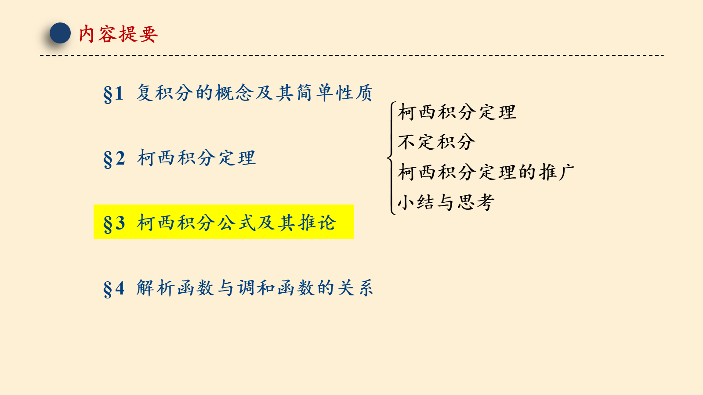

## 第 3 页

§3 Cauchy 积分公式及其推论
知识回顾
定理 3.10（复合闭路定理）
设 D 是由复周线
函数 f (z) 在 D 内解析，
所围成的有界 n + 1-连通区域，
则
或写作
复合闭路定理可以把大范围的不规则围道上的积分转化为奇点周围的规则围道上的积分（的和）.

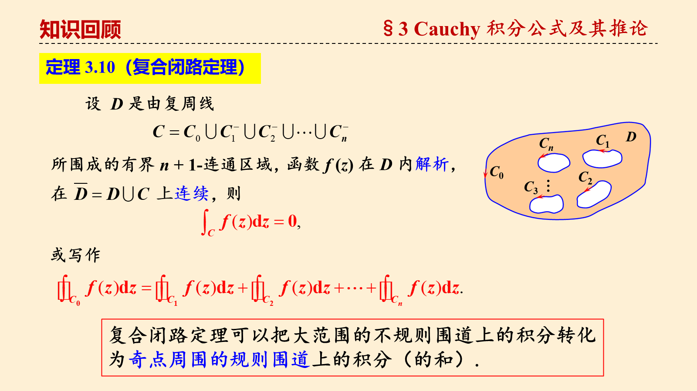

## 第 4 页

§3 Cauchy 积分公式及其推论
Cauchy 积分公式的内容
定理 3.11（Cauchy 积分公式）

## 第 5 页

§3 Cauchy 积分公式及其推论
严格证明

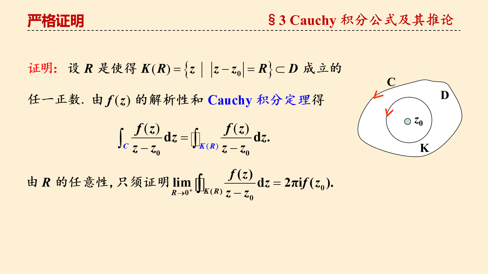

## 第 6 页

§3 Cauchy 积分公式及其推论
严格证明

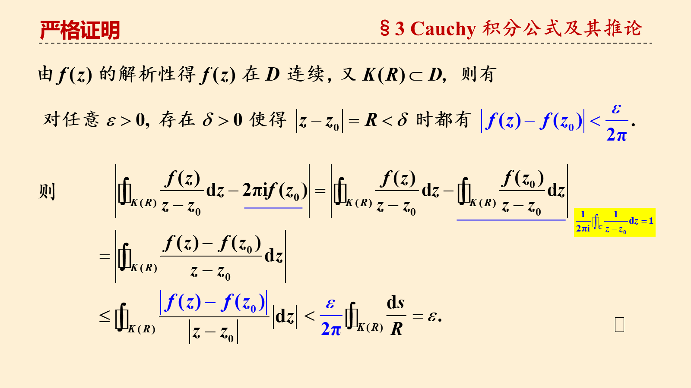

## 第 7 页

§3 Cauchy 积分公式及其推论
几点说明
1. 被积函数           的分子         是解析函数，分母是 z 的一次因式，则    是被积函数在积分曲线内部的唯一奇点     .

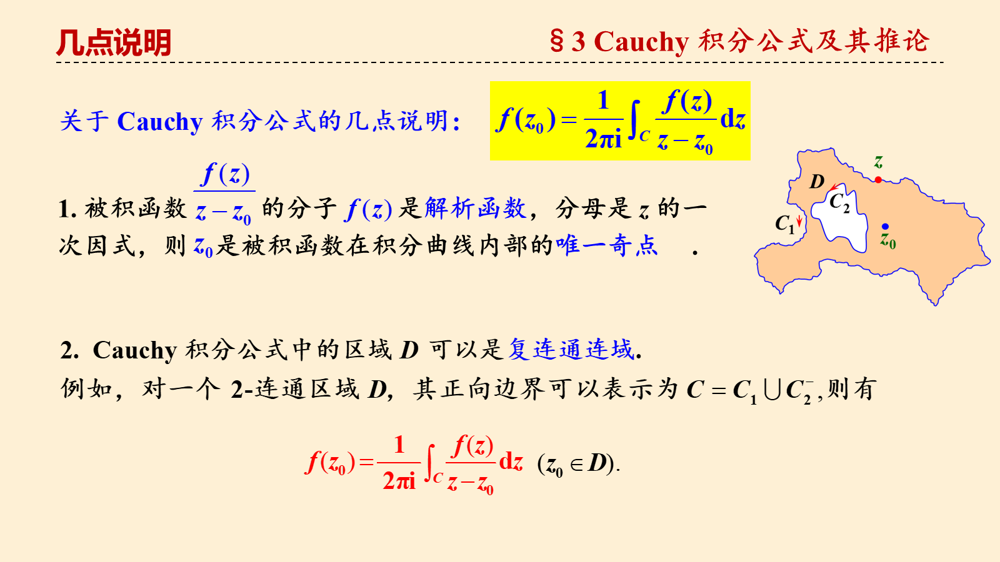

## 第 8 页

§3 Cauchy 积分公式及其推论
几点说明
即：
（证明留作练习）

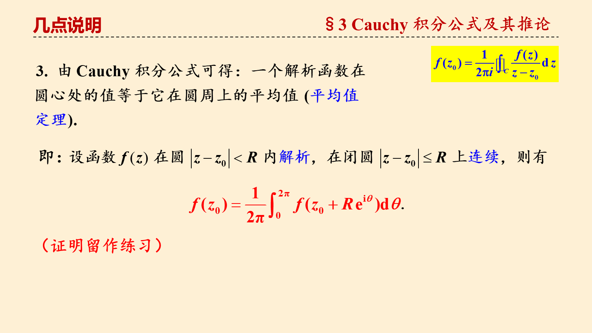

## 第 9 页

§3 Cauchy 积分公式及其推论
应用

## 第 10 页

§3 Cauchy积分公式及其推论
为两个充分小（被C包围）的圆

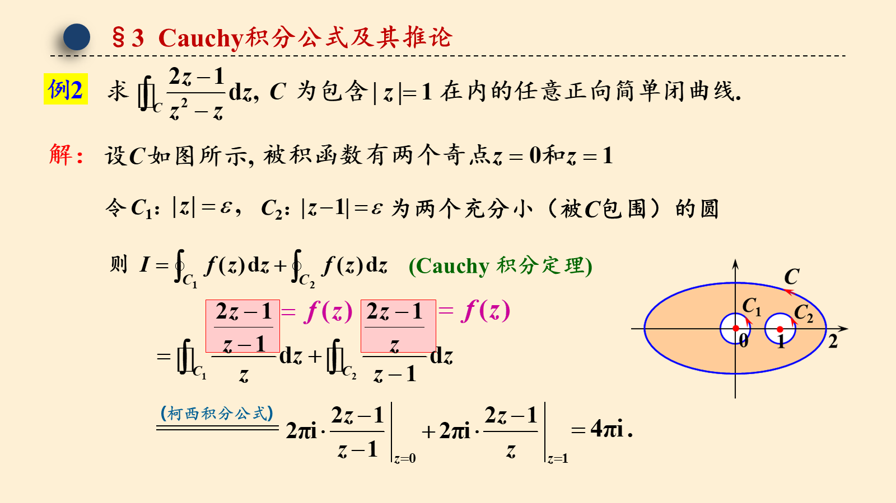

## 第 11 页

§3 Cauchy积分公式及其推论

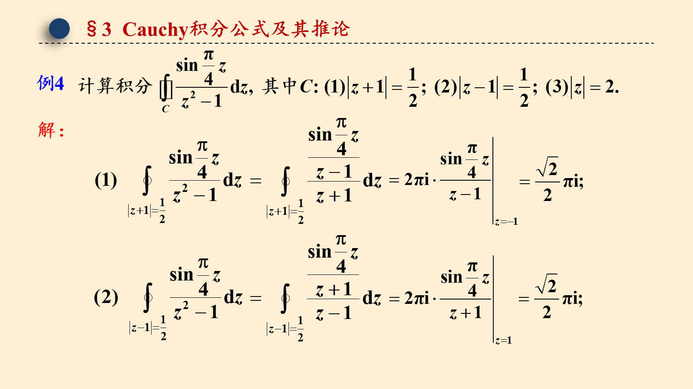

## 第 12 页

§3 Cauchy积分公式及其推论
由 Cauchy 积分定理, 得

## 第 13 页

§3 Cauchy积分公式及其推论
Cauchy 积分公式
……
解析函数是否有高阶导数?

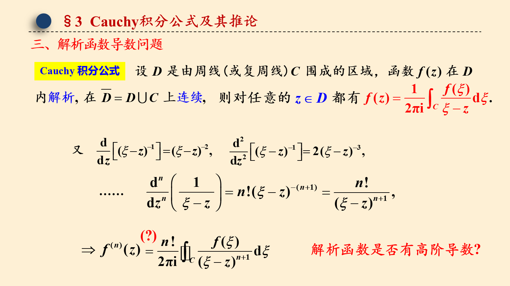

## 第 14 页

§3 Cauchy积分公式及其推论

## 第 15 页

§3 Cauchy积分公式及其推论
应用
作为后续理论的基础.

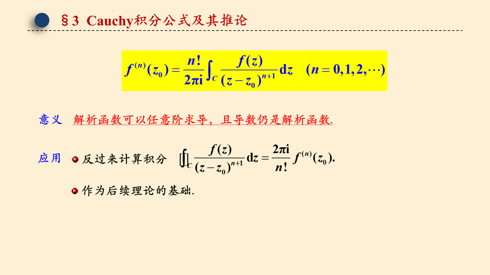

## 第 16 页

§3 Cauchy积分公式及其推论

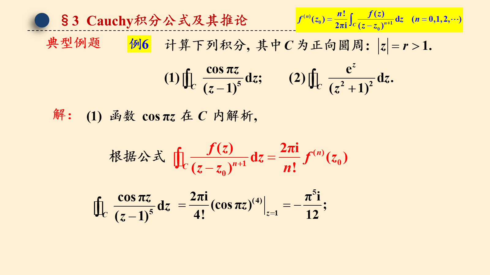

## 第 17 页

§3 Cauchy积分公式及其推论

## 第 18 页

§3 Cauchy积分公式及其推论

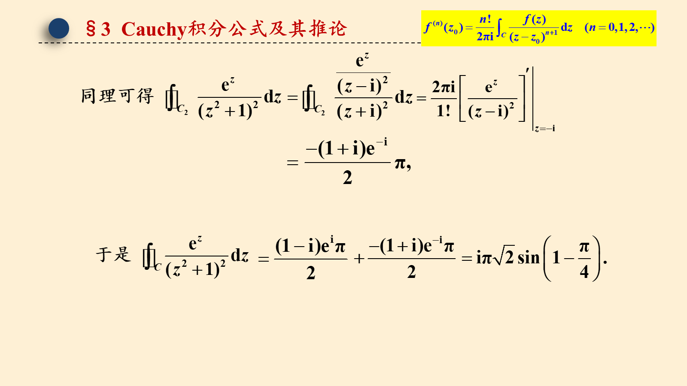

## 第 19 页

§3 Cauchy积分公式及其推论

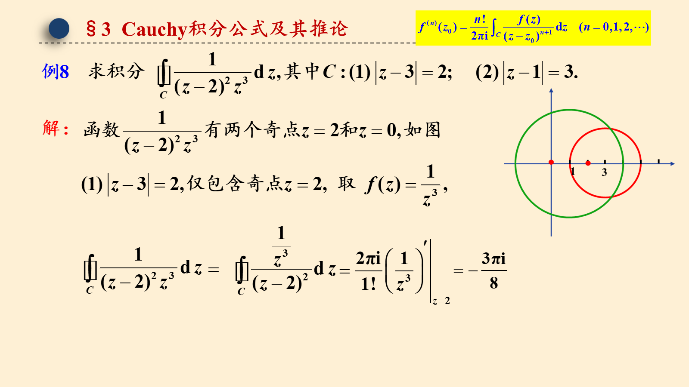

## 第 20 页

§3 Cauchy积分公式及其推论

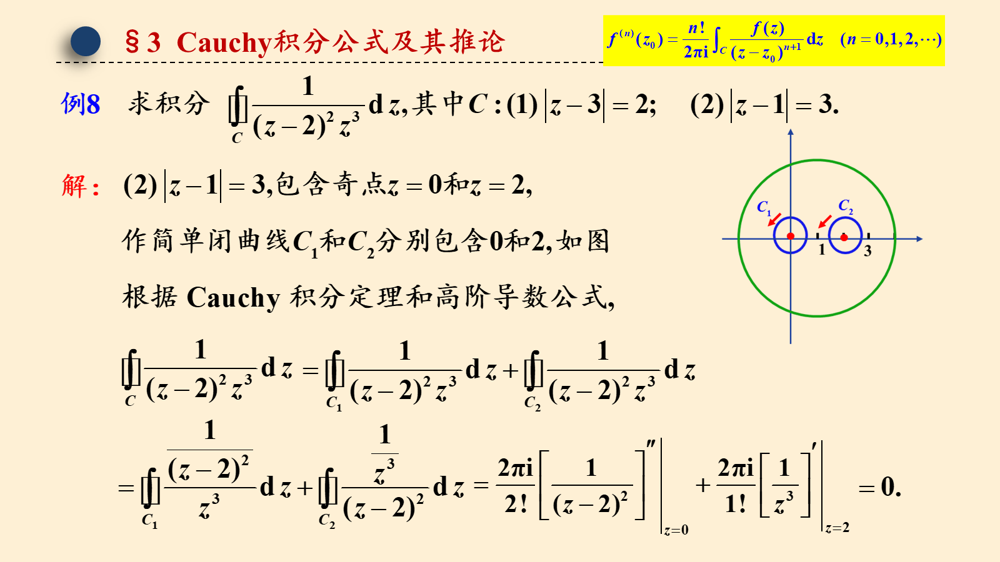

## 第 21 页

§3 Cauchy积分公式及其推论

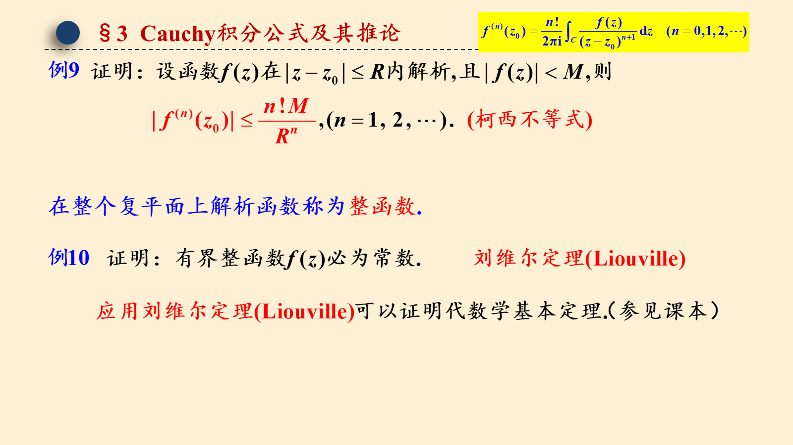

## 第 22 页

§3 Cauchy积分公式及其推论

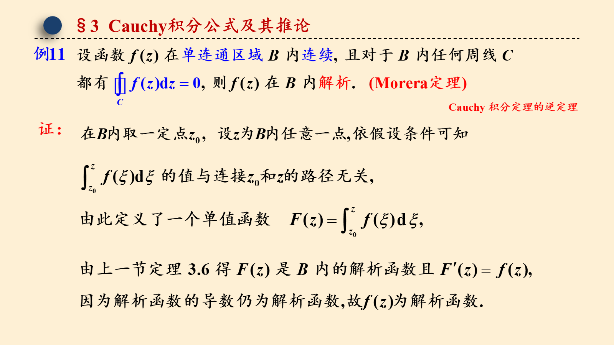

## 第 23 页

§3 Cauchy积分公式及其推论
判断解析函数的方法：
方法一
用定义判断
用 C-R 方程判断:
方法二
用 Morera 定理判断:
方法三

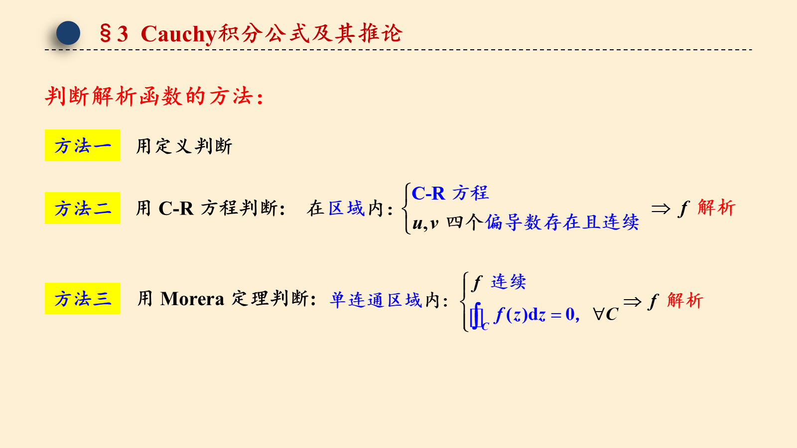

## 第 24 页

§3 Cauchy 积分公式及其推论
课后思考

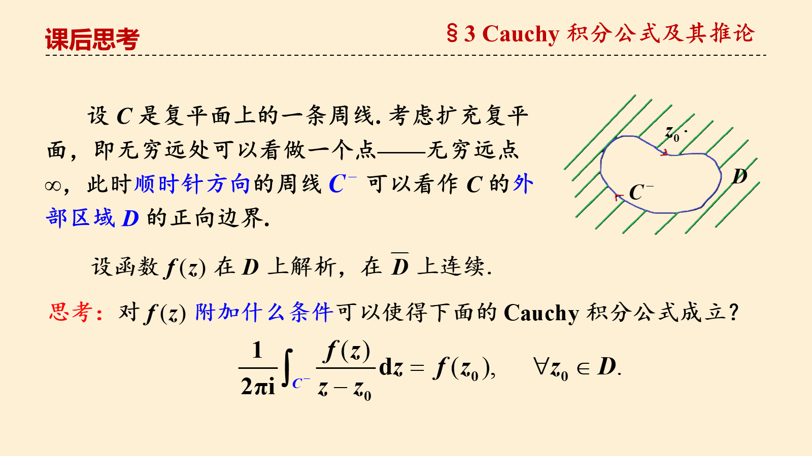

## 第 25 页

§3 作业

教材第三章习题

（一）9；12

（二）6

