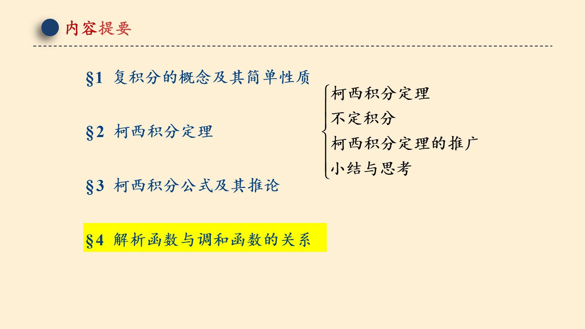
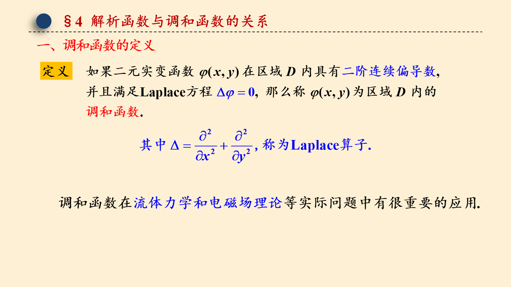
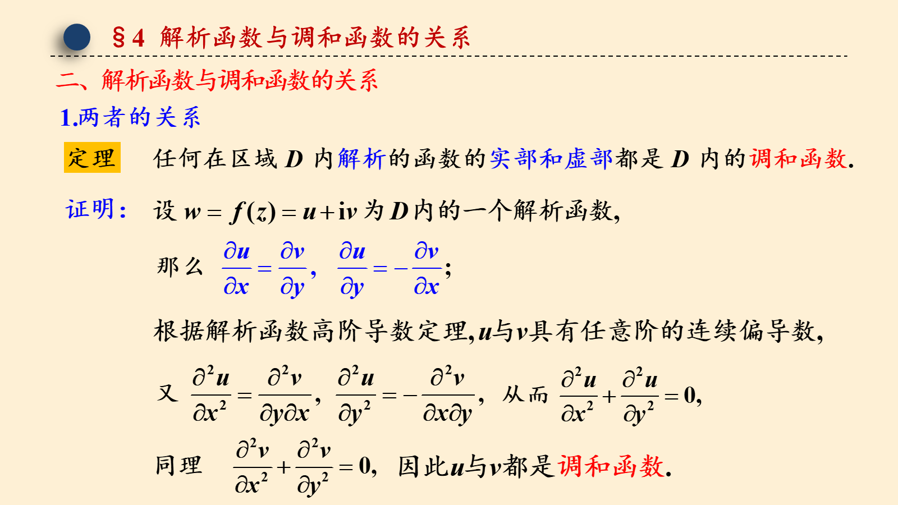
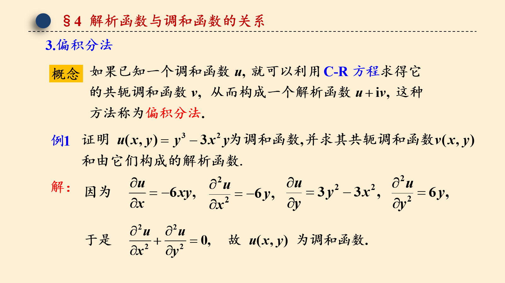
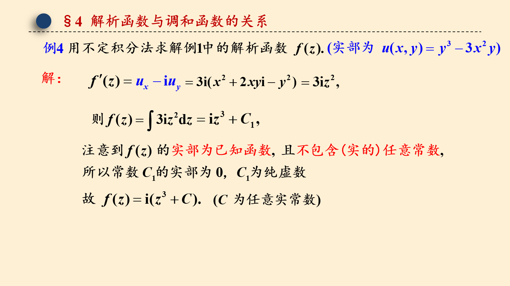
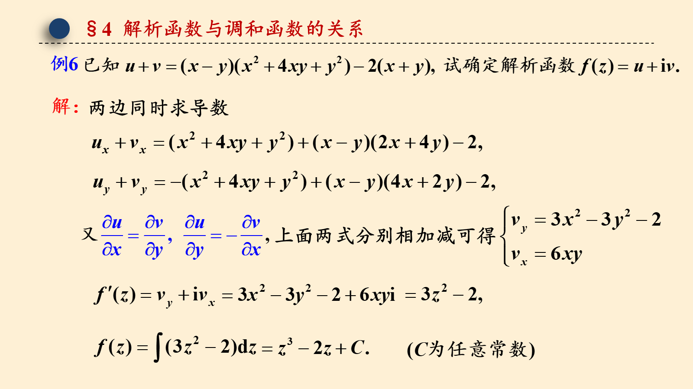

# 3.4 解析函数与调和函数的关系

> 来源：3.4 解析函数与调和函数的关系.pptx，共 17 页。
> 公式与图形较多，含图页保留整页图像以保证版式；纯文字页转为正文。

## 第 1 页

第三章 复变函数的积分

3.4 解析函数与调和函数的关系

梅杰

## 第 2 页

## 第 3 页

§4 解析函数与调和函数的关系

## 第 4 页

§4 解析函数与调和函数的关系

## 第 5 页

§4 解析函数与调和函数的关系

## 第 6 页

§4 解析函数与调和函数的关系

## 第 7 页

§4 解析函数与调和函数的关系

## 第 8 页

§4 解析函数与调和函数的关系

## 第 9 页

§4 解析函数与调和函数的关系

## 第 10 页

§4 解析函数与调和函数的关系

## 第 11 页

§4 解析函数与调和函数的关系

## 第 12 页

§4 解析函数与调和函数的关系
所求解析函数为

## 第 13 页

§4 解析函数与调和函数的关系
两边同时求导数
上面两式分别相加减可得

## 第 14 页

§4 解析函数与调和函数的关系

## 第 15 页

§4 解析函数与调和函数的关系

## 第 16 页

§4 解析函数与调和函数的关系

附：

人物介绍 ——柯西

柯西创造力惊人，数学论文像连绵不断的泉水在柯西的一生中喷涌，

他发表了789篇论文，出版专著7本，全集共有十四开本24卷，从他23

岁写出第一篇论文到68岁逝世的45年中，平均每月发表一至两篇论文.

1849年，仅在法国科学院8月至12月的9次会上，他就提交了24篇短文

和15篇研究报告. 柯西27岁即当选为法国科学院院士，还是英国皇家学

会会员和许多国家的科学院院士.

## 第 17 页

§4 作业

教材第三章习题

（一）16 (1)(2)

