# 4.4 解析函数零点的孤立性和解析函数的唯一性

> 来源：4.4 解析函数零点的孤立性和解析函数的唯一性.pptx，共 25 页。
> 公式与图形较多，含图页保留整页图像以保证版式；纯文字页转为正文。

## 第 1 页

第四章 解析函数的幂级数表示法

4.4 解析函数零点的孤立性和唯一性定理

梅杰

## 第 2 页

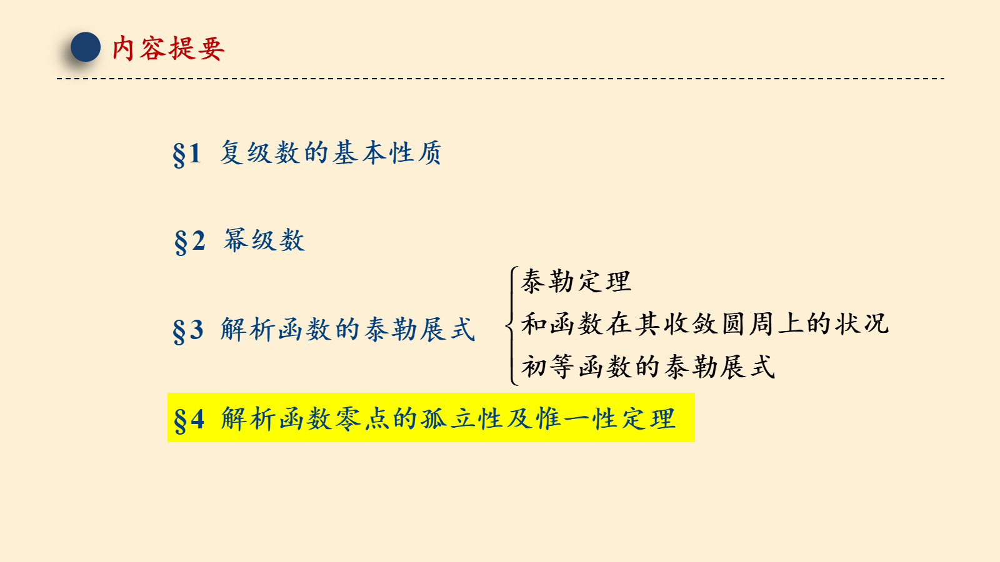

## 第 3 页

§4 解析函数零点的孤立性及惟一性定理
一  解析函数的零点的孤立性
1定义4.7

## 第 4 页

§4 解析函数零点的孤立性及惟一性定理
一  解析函数的零点的孤立性
3 定理4.18
“必要性”
则

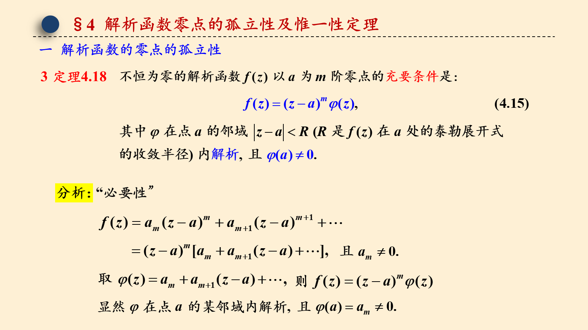

## 第 5 页

§4 解析函数零点的孤立性及惟一性定理
“充分性”
由Taylor定理
从而

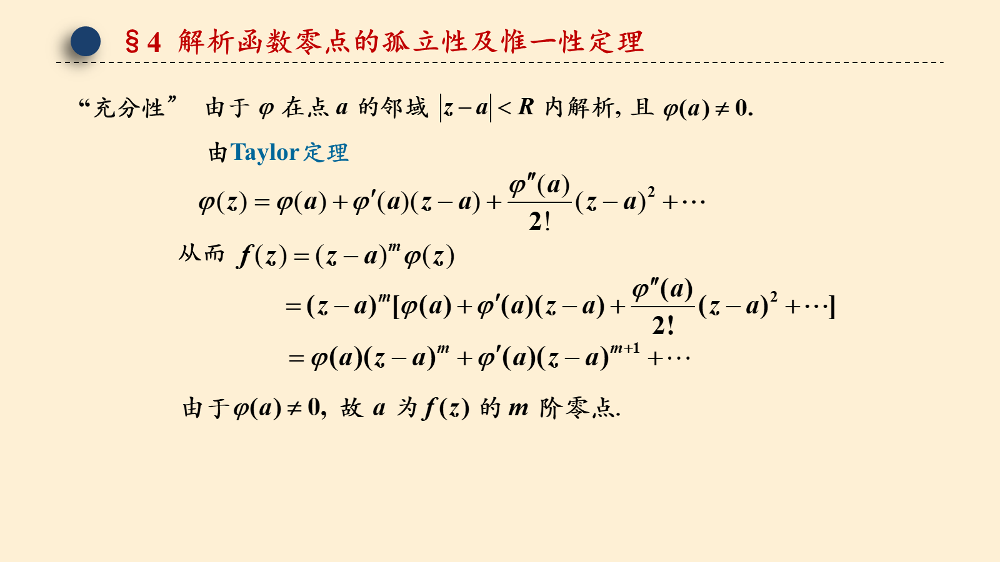

## 第 6 页

§4 解析函数零点的孤立性及惟一性定理
零点阶数的充要条件

## 第 7 页

§4 解析函数零点的孤立性及惟一性定理
解：

## 第 8 页

§4 解析函数零点的孤立性及惟一性定理
解：
解：

## 第 9 页

§4 解析函数零点的孤立性及惟一性定理

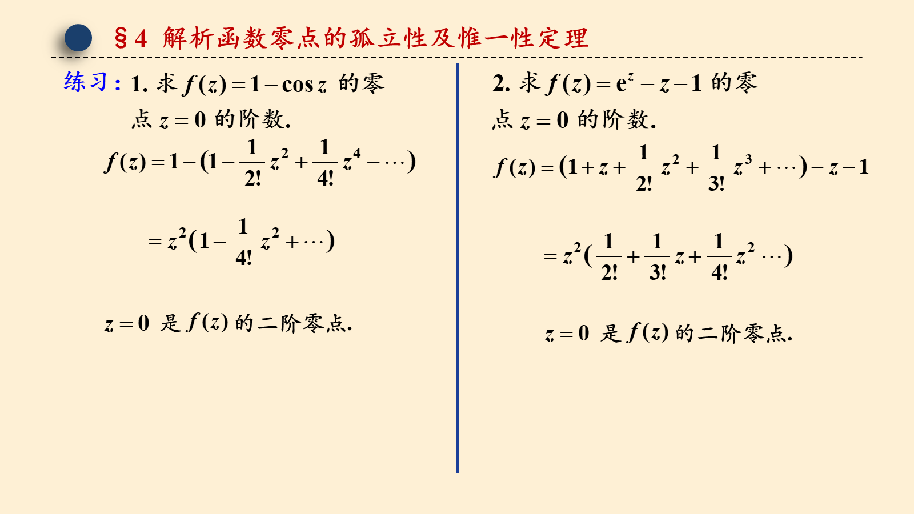

## 第 10 页

§4 解析函数零点的孤立性及惟一性定理

## 第 11 页

§4 解析函数零点的孤立性及惟一性定理

## 第 12 页

§4 解析函数零点的孤立性及惟一性定理
零点阶数的充要条件

## 第 13 页

§4 解析函数零点的孤立性及惟一性定理
4 定理4.19 (解析函数零点的孤立性)

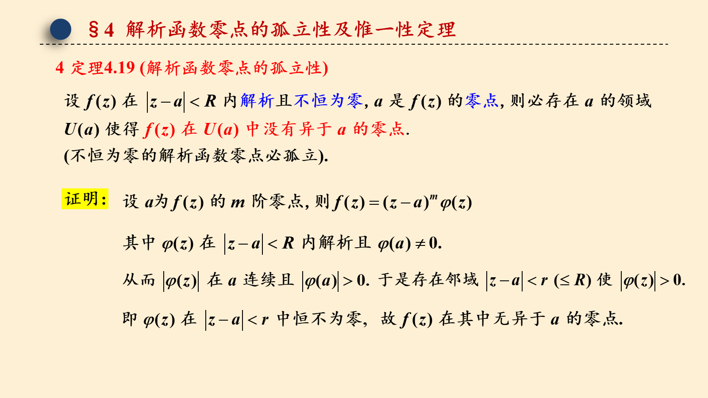

## 第 14 页

§4 解析函数零点的孤立性及惟一性定理

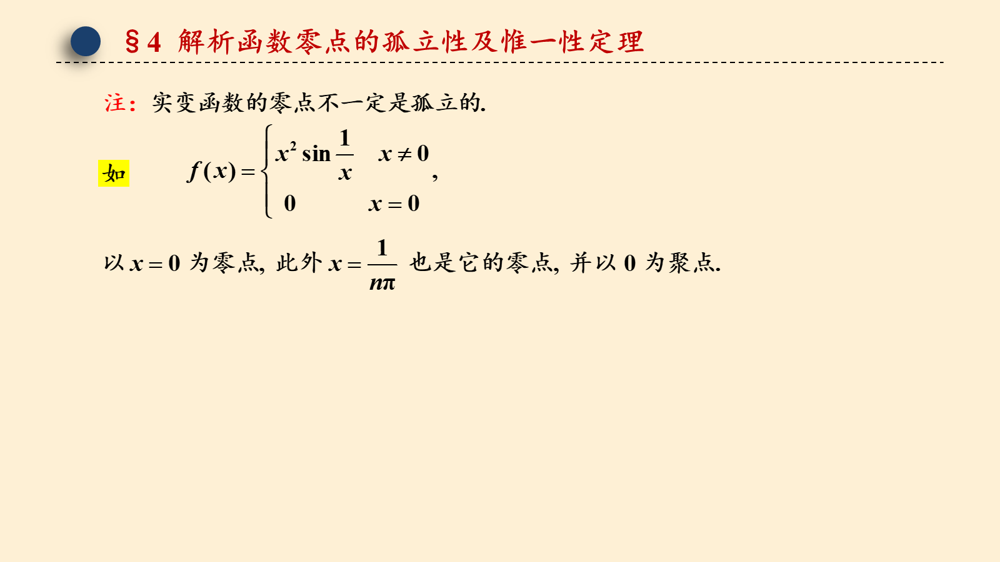

## 第 15 页

§4 解析函数零点的孤立性及惟一性定理
4 定理4.19 (解析函数零点的孤立性)
5  推论4.20

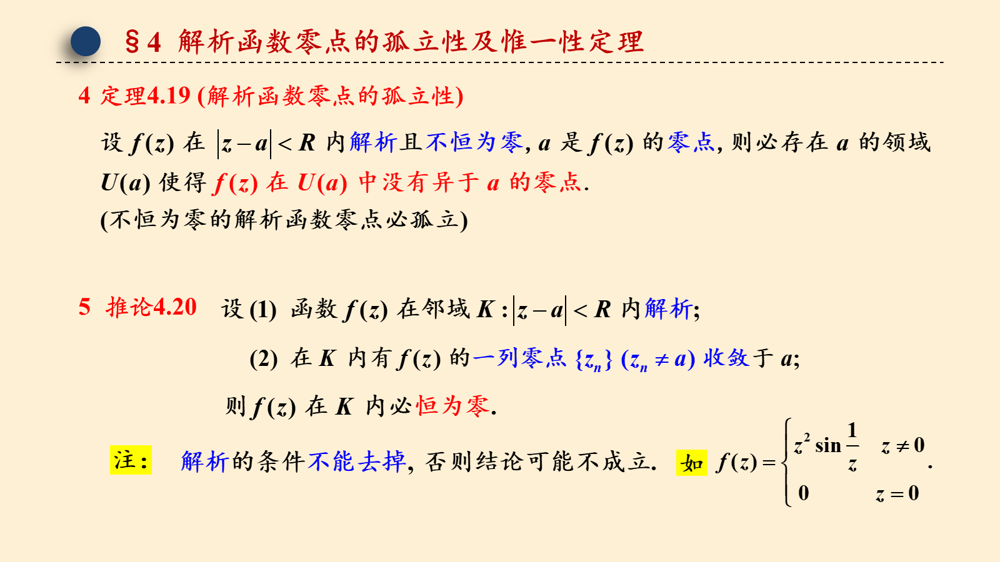

## 第 16 页

§4 解析函数零点的孤立性及惟一性定理
二 解析函数的唯一性
1 定理4.21
2  推论4.22

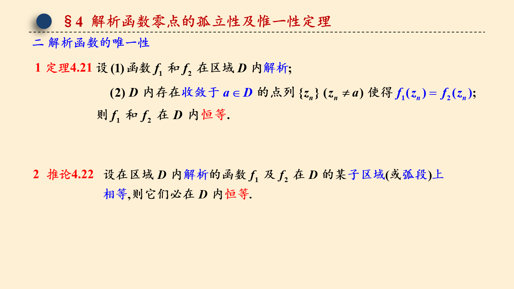

## 第 17 页

§4 解析函数零点的孤立性及惟一性定理
注 1
注 2

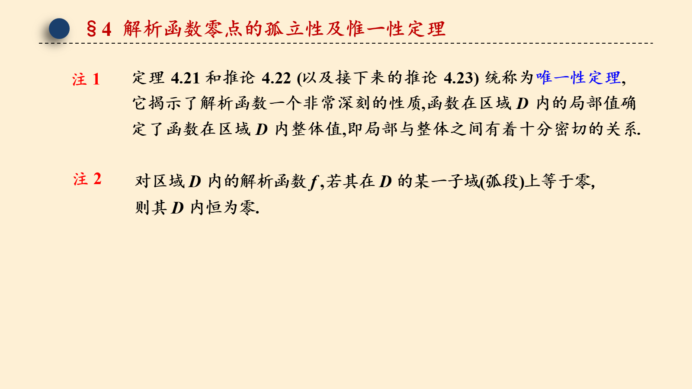

## 第 18 页

§4 解析函数零点的孤立性及惟一性定理
例 6

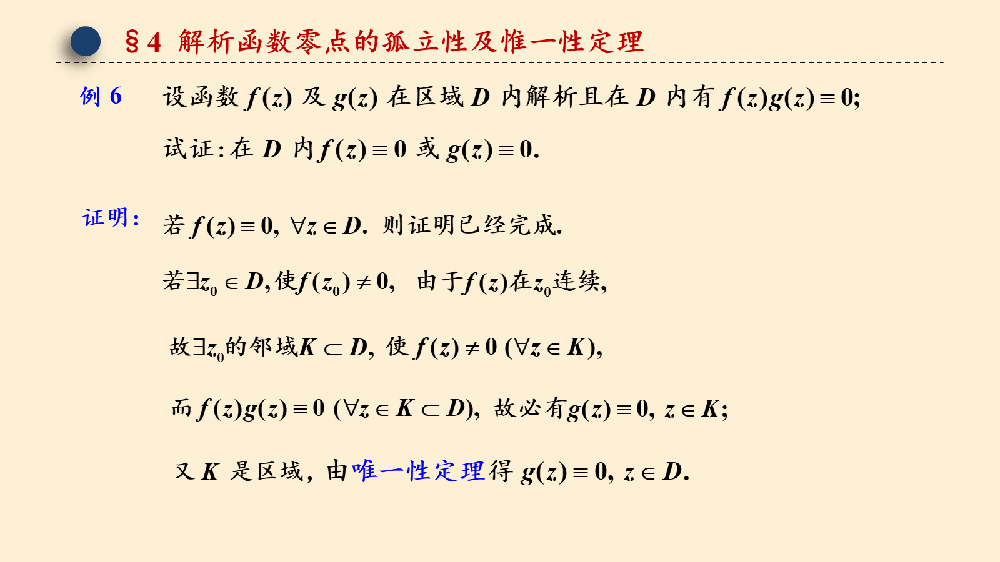

## 第 19 页

§4 解析函数零点的孤立性及惟一性定理
二 解析函数的唯一性
3  推论4.23
例 8

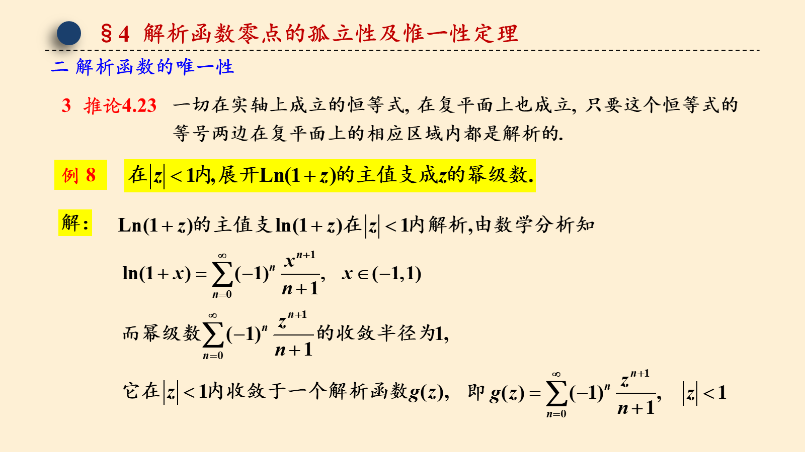

## 第 20 页

§4 解析函数零点的孤立性及惟一性定理

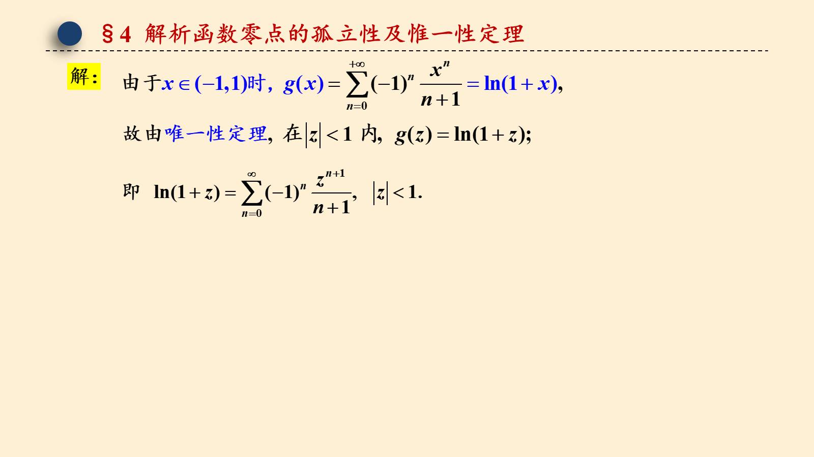

## 第 21 页

§4 解析函数零点的孤立性及惟一性定理
三 最大模原理
1  定理4.24

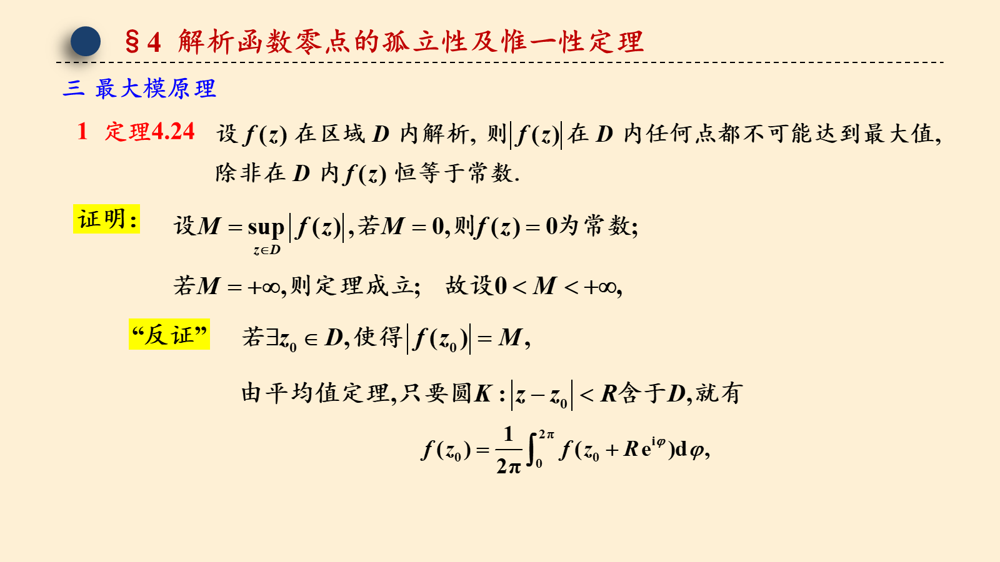

## 第 22 页

§4 解析函数零点的孤立性及惟一性定理
矛盾.

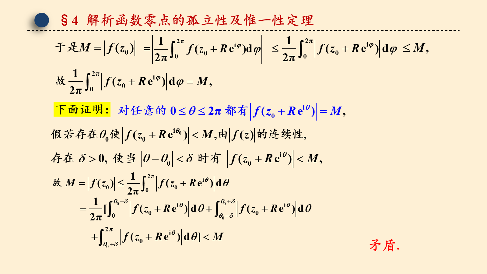

## 第 23 页

§4 解析函数零点的孤立性及惟一性定理
因此，我们证明了,
注
解析函数在边界上的最大模可以限制其在区域内的最大模.

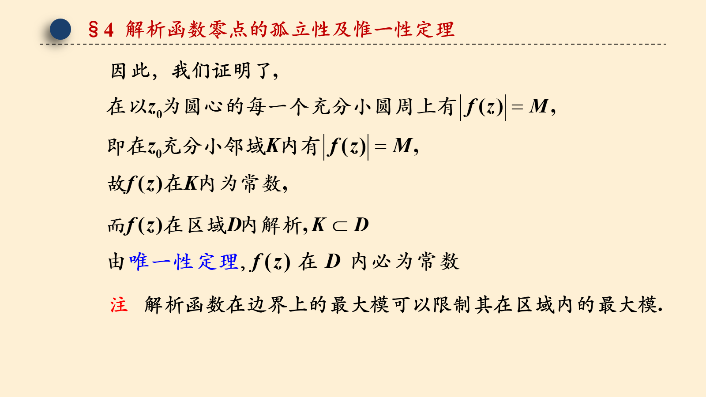

## 第 24 页

§4 解析函数零点的孤立性及惟一性定理
三 最大模原理
2  推论4.25
注1: 有界闭域上解析函数的最大模只能在边界取得.
注2:

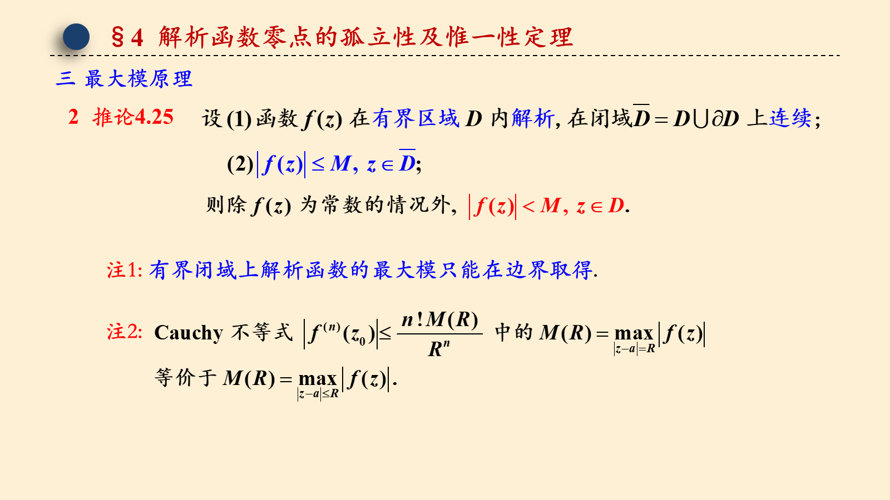

## 第 25 页

§4 作业

教材第四章习题

（一）8；9；12.

