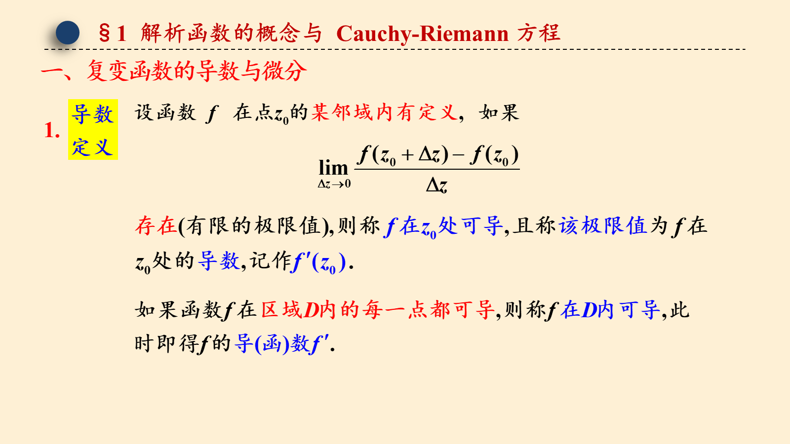
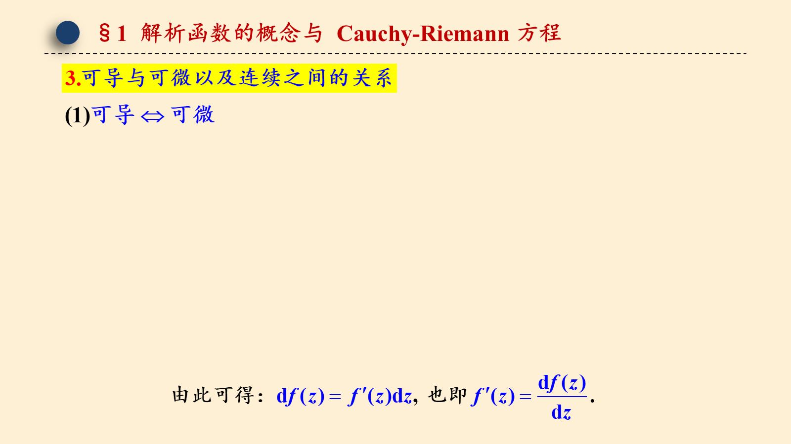
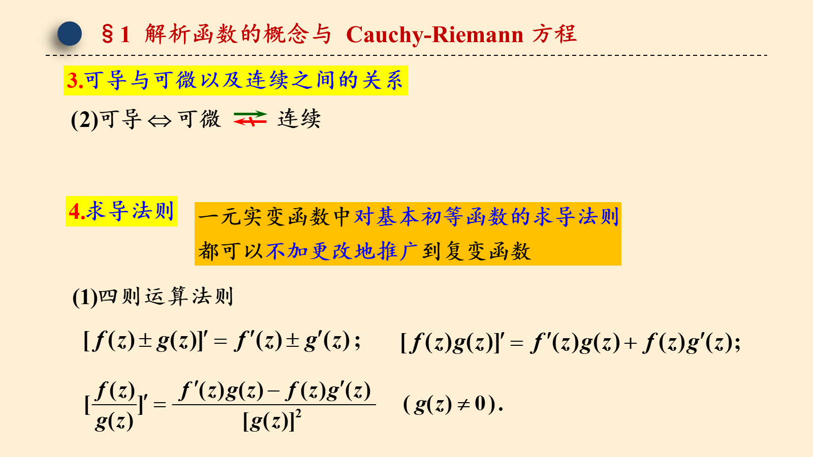
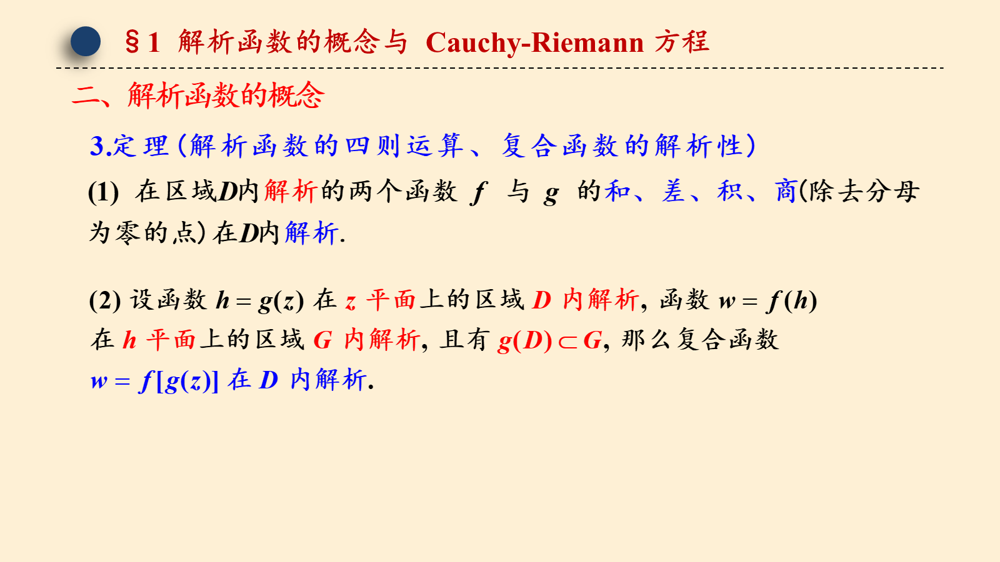
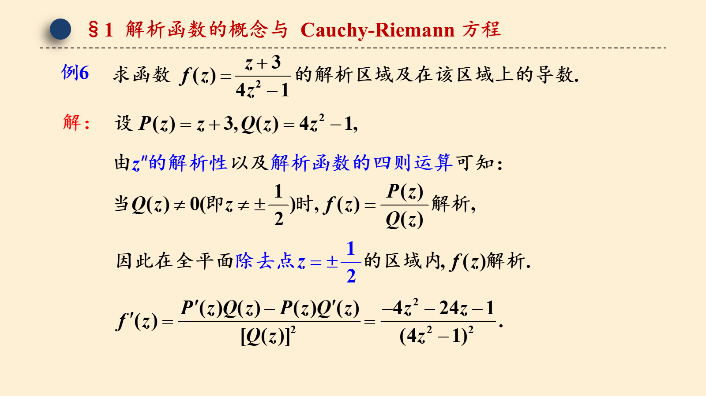
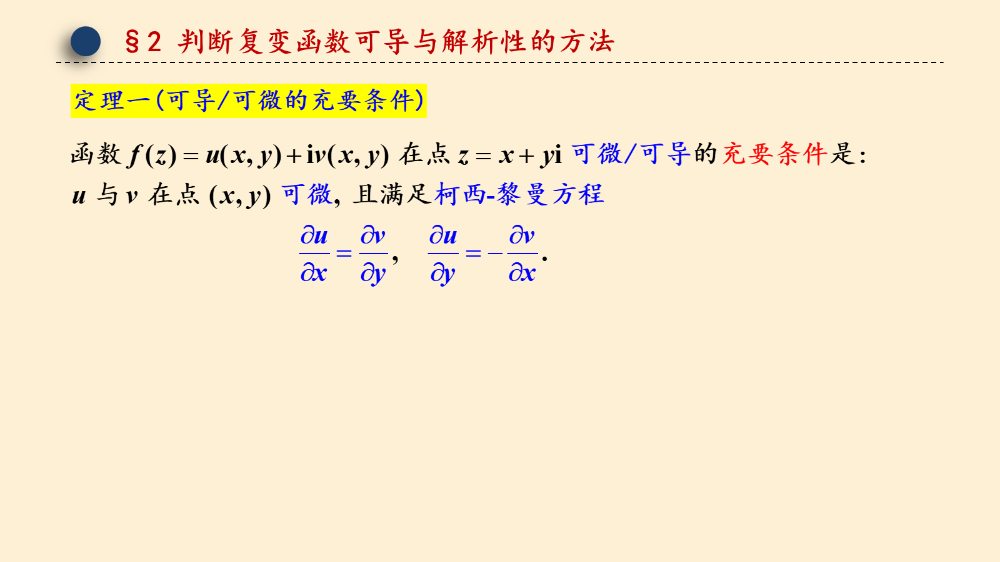
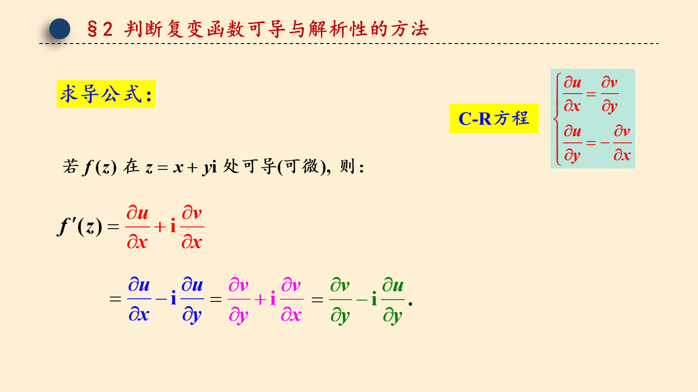
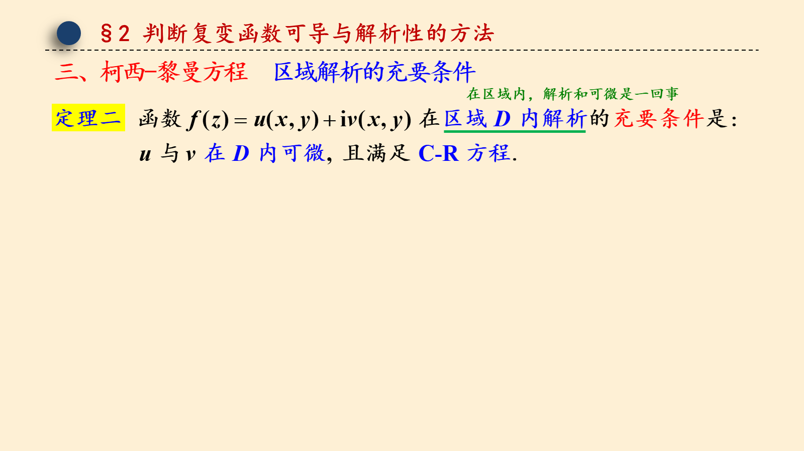
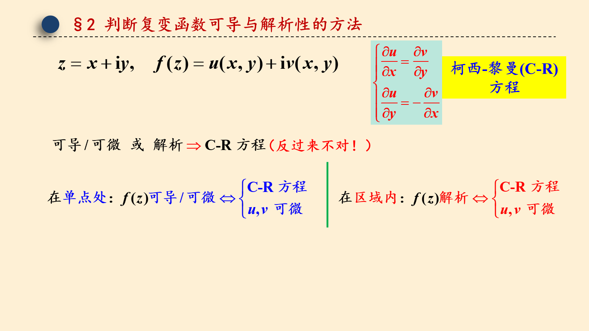

# 2.1 解析函数与 Cauchy-Riemann 方程

> 来源：2.1 解析函数与 Cauchy-Riemann 方程.pptx，共 16 页。
> 公式与图形较多，含图页保留整页图像以保证版式；纯文字页转为正文。

## 第 1 页

第二章 解析函数

2.1 解析函数与 Cauchy-Riemann 方程

梅杰

## 第 2 页

§1 解析函数的概念与 Cauchy-Riemann 方程

## 第 3 页

§1 解析函数的概念与 Cauchy-Riemann 方程

## 第 4 页

§1 解析函数的概念与 Cauchy-Riemann 方程

## 第 5 页

§1 解析函数的概念与 Cauchy-Riemann 方程

## 第 6 页

§1 解析函数的概念与 Cauchy-Riemann 方程

## 第 7 页

§1 解析函数的概念与 Cauchy-Riemann 方程

## 第 8 页

§1 解析函数的概念与 Cauchy-Riemann 方程

## 第 9 页

§1 解析函数的概念与 Cauchy-Riemann 方程

## 第 10 页

§2 判断复变函数可导与解析性的方法

## 第 11 页

§2 判断复变函数可导与解析性的方法
C-R方程

## 第 12 页

§2 判断复变函数可导与解析性的方法

## 第 13 页

§2 判断复变函数可导与解析性的方法
柯西-黎曼(C-R)方程
（反过来不对！）

## 第 14 页

§2 判断复变函数可导与解析性的方法

## 第 15 页

§2 判断复变函数可导与解析性的方法

## 第 16 页

§2 判断复变函数可导与解析性的方法

