# 2.2-2.3 初等解析函数 初等多值函数（两次课的内容）

> 来源：2.2-2.3 初等解析函数 初等多值函数（两次课的内容）.pptx，共 30 页。
> 公式与图形较多，含图页保留整页图像以保证版式；纯文字页转为正文。

## 第 1 页

第二章 解析函数

2.2-2.3 初等解析函数 初等多值函数

梅杰

## 第 2 页

§2 初等解析函数

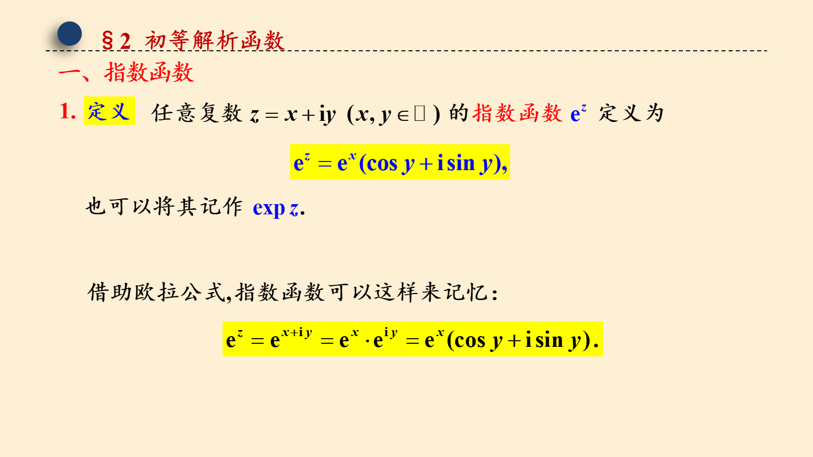

## 第 3 页

§2 初等解析函数

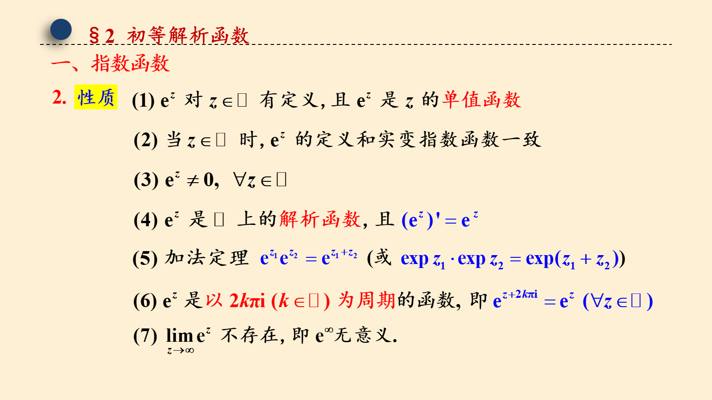

## 第 4 页

§2 初等解析函数

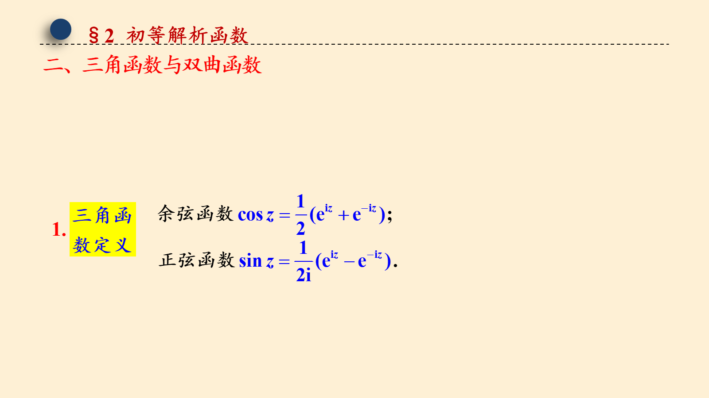

## 第 5 页

§2 初等解析函数

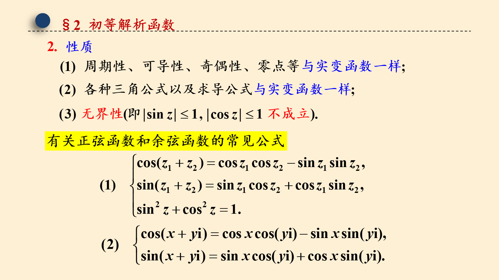

## 第 6 页

§2 初等解析函数

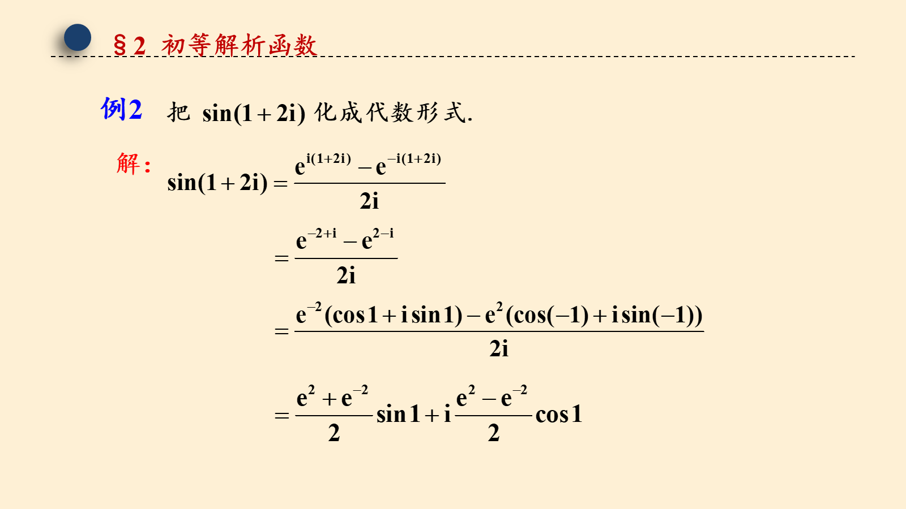

## 第 7 页

§3 复变初等函数

## 第 8 页

§3 复变初等函数
(1) 根式函数的多值性.

## 第 9 页

§3 复变初等函数
理论上的的做法：
从原点 O 起到点 ∞ 任意引一条射线将 z 平面割破，该直线称为割线，在割破了的平面(构成以此割线为边界的区域，记为 G)上可将             转化为单值函数来研究
z
常用的做法：
G
从原点起沿着负实轴将z平面割破：

## 第 10 页

§3 复变初等函数

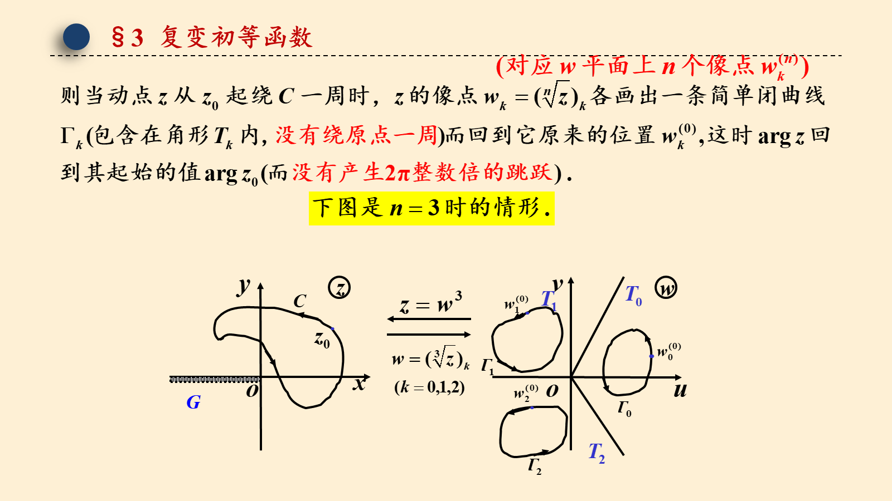

## 第 11 页

§3 复变初等函数
定义

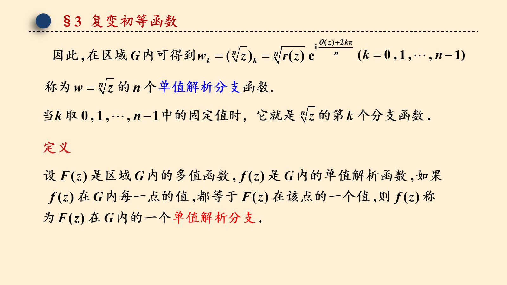

## 第 12 页

§3 复变初等函数
结论：
从原点起沿着负实轴将z平面割破,即可将根式函数:

## 第 13 页

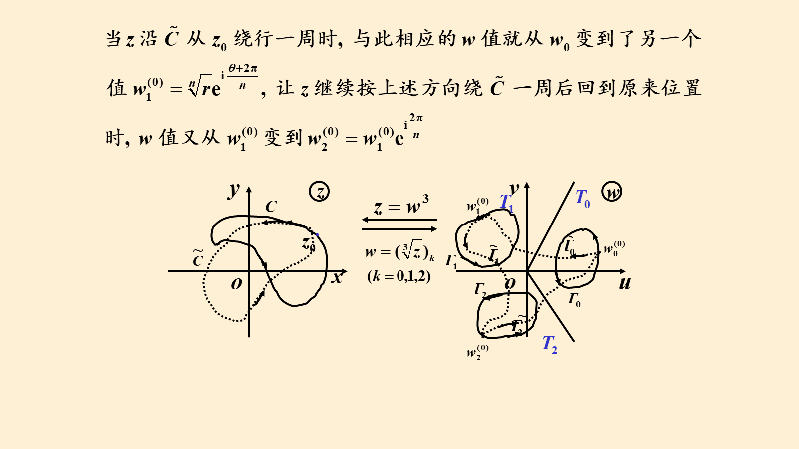

## 第 14 页

§3 复变初等函数

## 第 15 页

§3 复变初等函数

## 第 16 页

§3 复变初等函数
注 3：

## 第 17 页

§3 复变初等函数
对数函数的多值性
记忆：

## 第 18 页

§3 复变初等函数

## 第 19 页

§3 复变初等函数

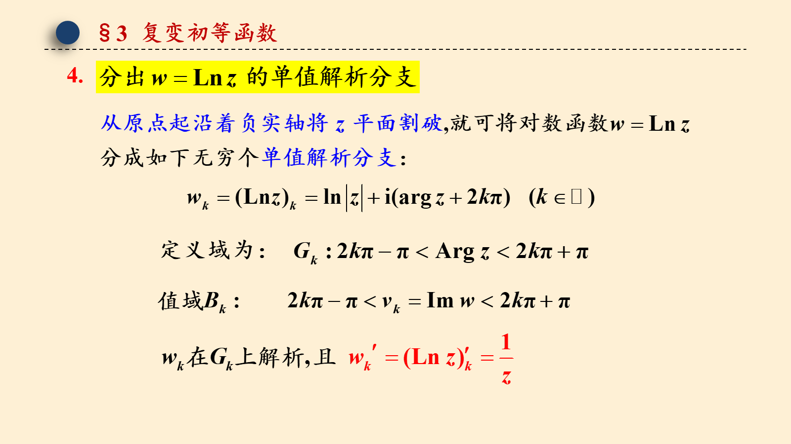

## 第 20 页

§3 复变初等函数

## 第 21 页

§3 复变初等函数

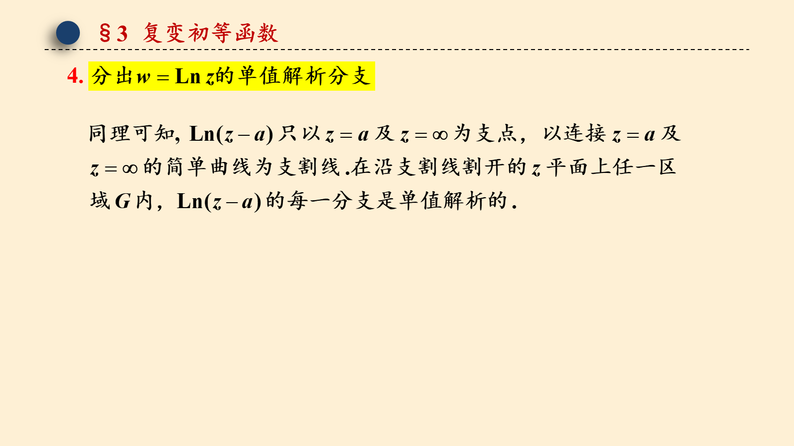

## 第 22 页

§3 初等多值函数

## 第 23 页

§3 初等多值函数

## 第 24 页

§3 初等多值函数

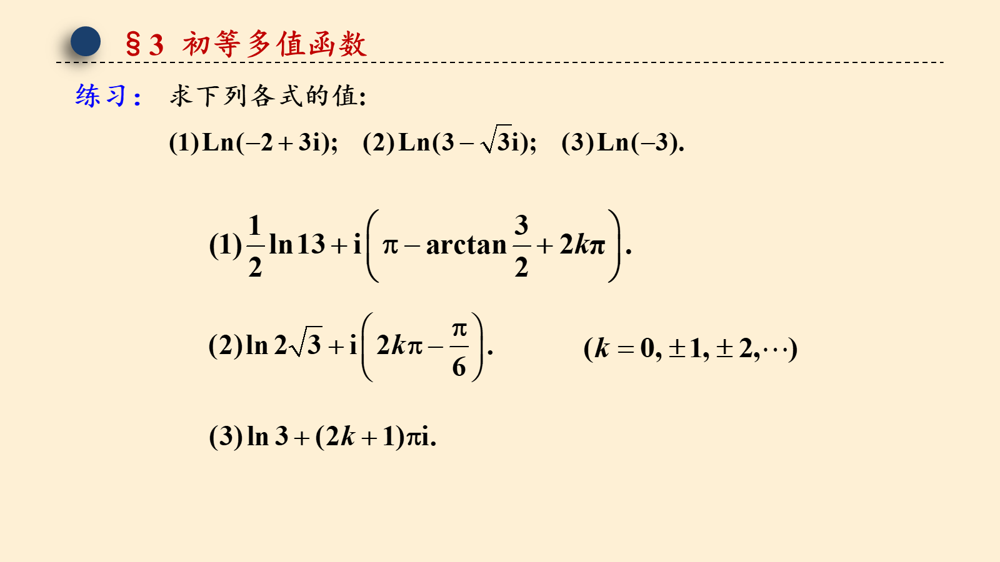

## 第 25 页

§3 初等多值函数

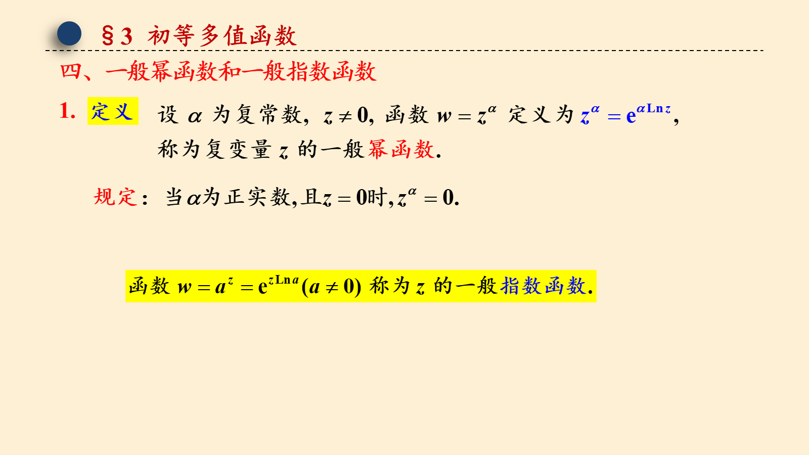

## 第 26 页

§3 初等多值函数

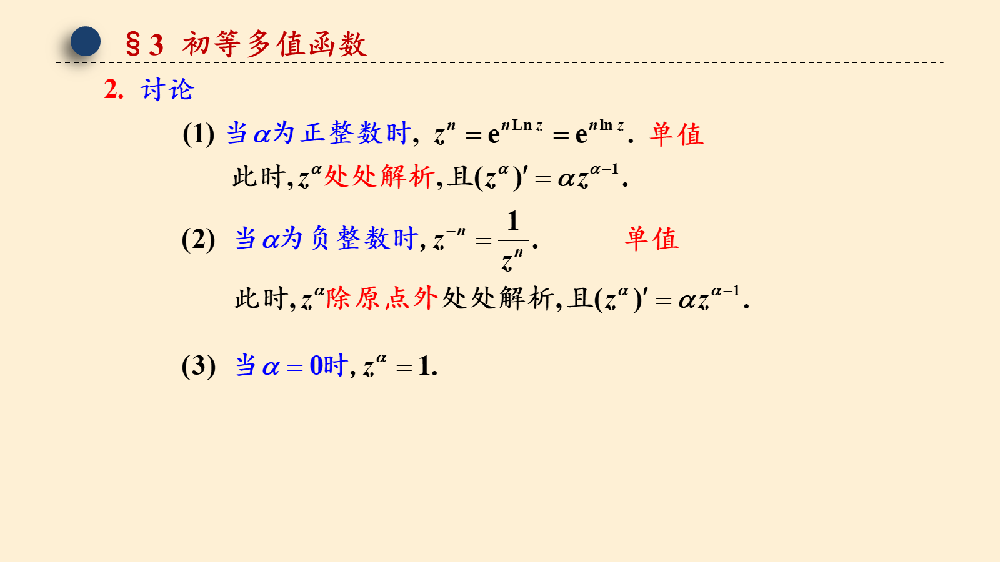

## 第 27 页

§3 初等多值函数

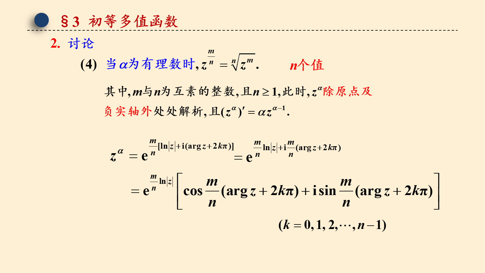

## 第 28 页

§3 初等多值函数

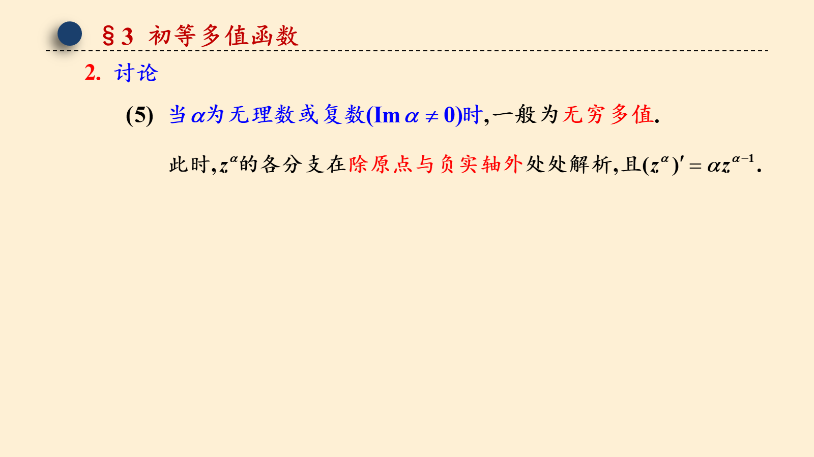

## 第 29 页

§3 初等多值函数

## 第 30 页

§3 初等多值函数

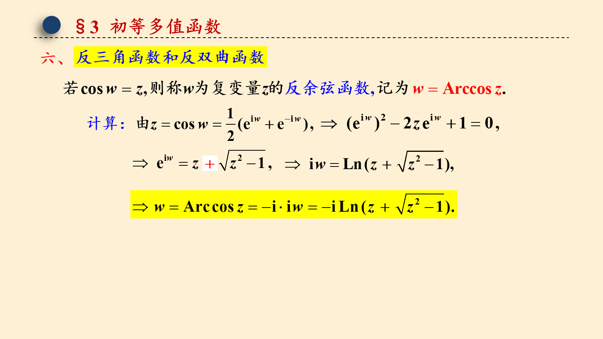

