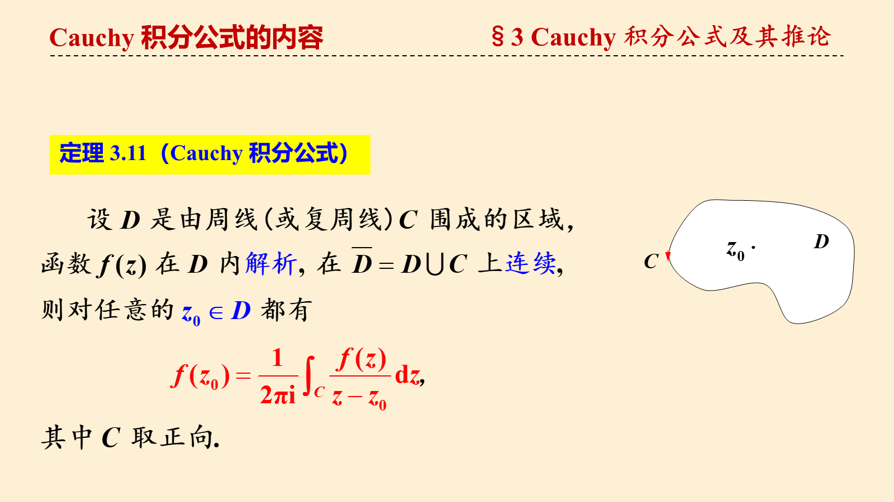
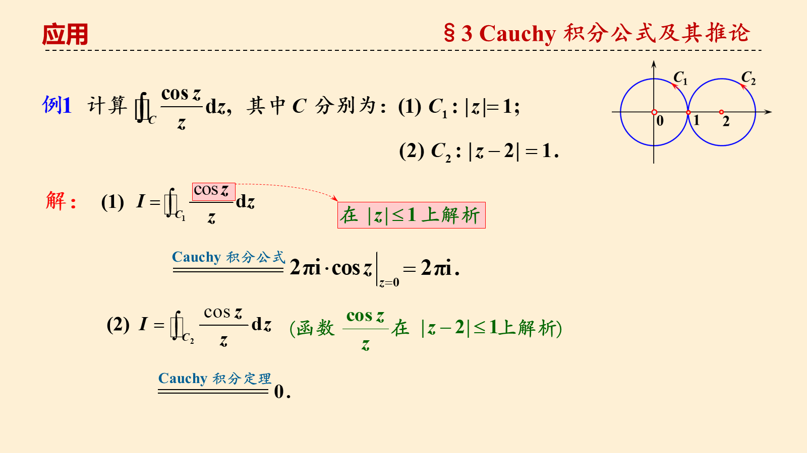
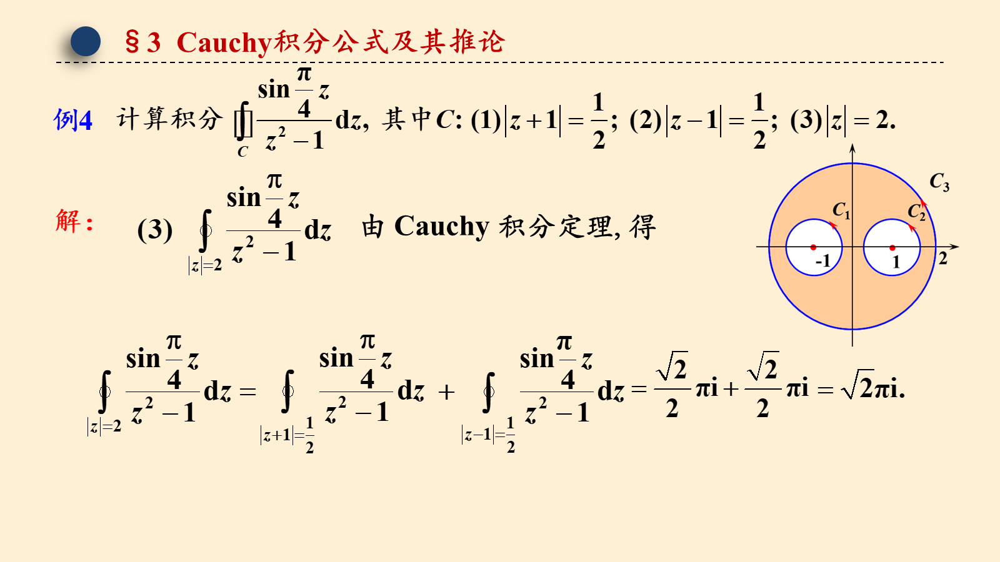
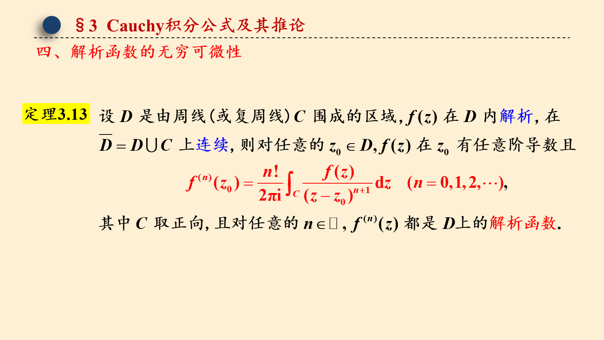
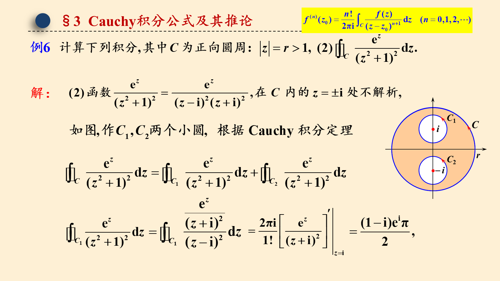

# 3.3 Cauchy 积分公式及其推论

> 来源：3.3 Cauchy 积分公式及其推论.pptx，共 14 页。
> 公式与图形较多，含图页保留整页图像以保证版式；纯文字页转为正文。

## 第 1 页

第三章 复变函数的积分

3.3 Cauchy 积分公式及其推论

梅杰

## 第 2 页

§3 Cauchy 积分公式及其推论
Cauchy 积分公式的内容
定理 3.11（Cauchy 积分公式）

## 第 3 页

§3 Cauchy 积分公式及其推论
几点说明
1. 被积函数           的分子         是解析函数，分母是 z 的一次因式，则    是被积函数在积分曲线内部的唯一奇点     .

## 第 4 页

§3 Cauchy 积分公式及其推论
应用

## 第 5 页

§3 Cauchy积分公式及其推论
为两个充分小（被C包围）的圆

## 第 6 页

§3 Cauchy积分公式及其推论

## 第 7 页

§3 Cauchy积分公式及其推论
由 Cauchy 积分定理, 得

## 第 8 页

§3 Cauchy积分公式及其推论

## 第 9 页

§3 Cauchy积分公式及其推论
应用
作为后续理论的基础.

## 第 10 页

§3 Cauchy积分公式及其推论

## 第 11 页

§3 Cauchy积分公式及其推论

## 第 12 页

§3 Cauchy积分公式及其推论

## 第 13 页

§3 Cauchy积分公式及其推论

## 第 14 页

§3 Cauchy积分公式及其推论

