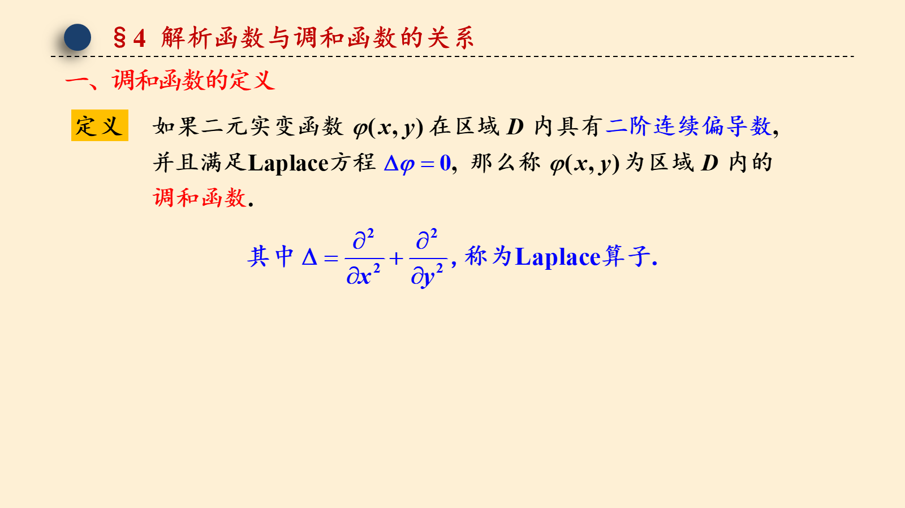
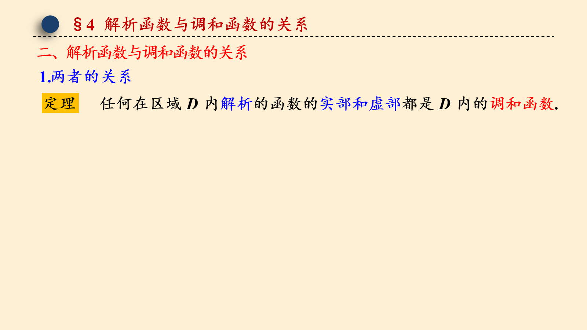
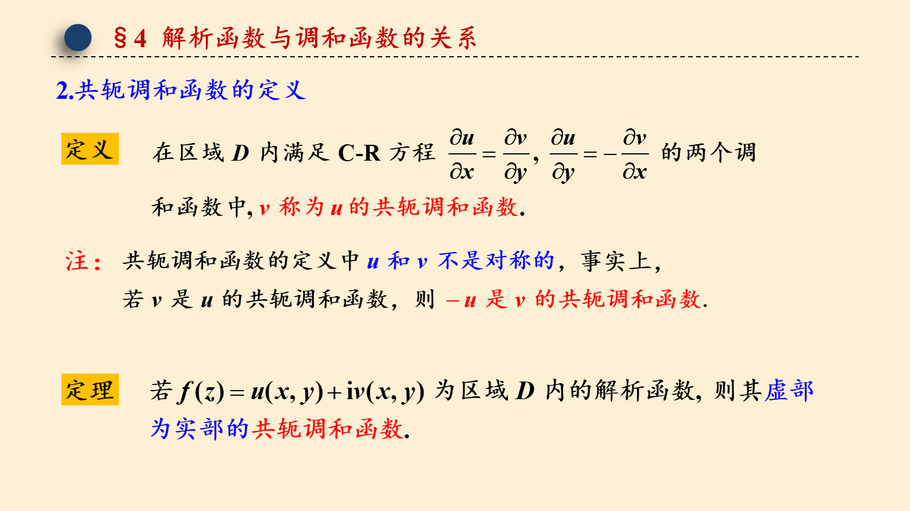
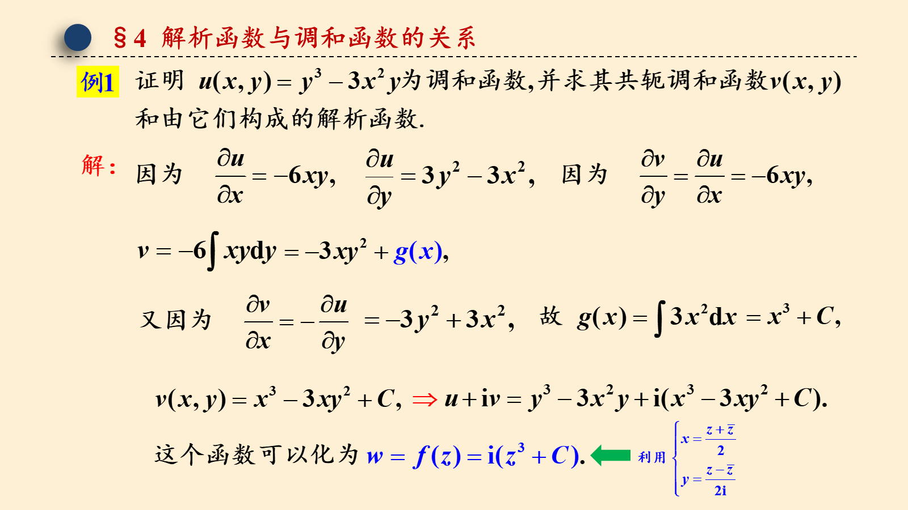
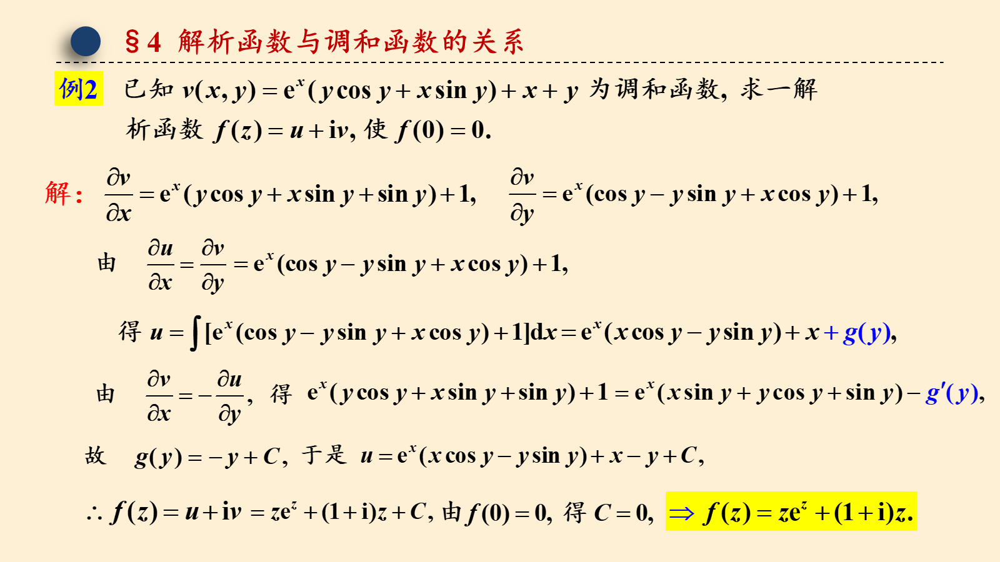
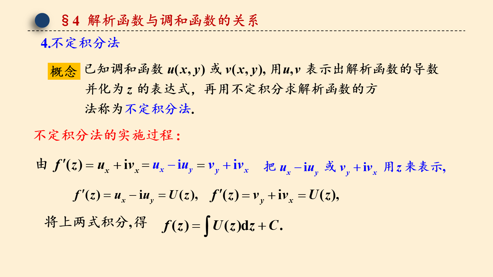
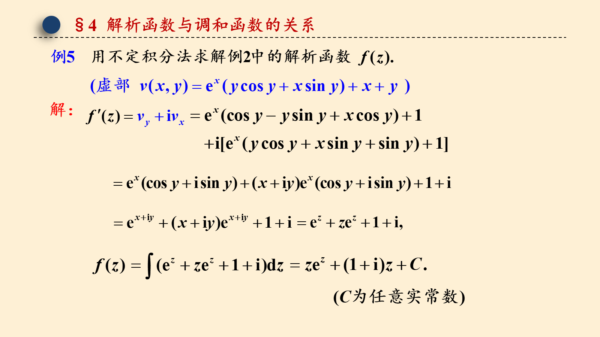
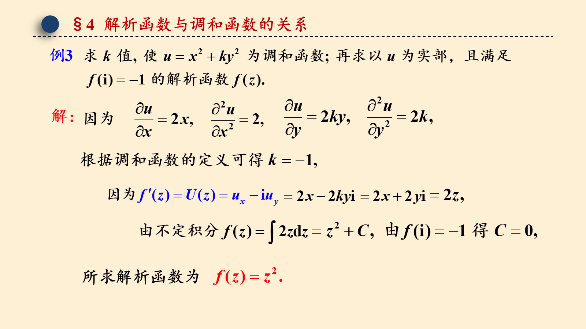

# 3.4 解析函数与调和函数的关系

> 来源：3.4 解析函数与调和函数的关系.pptx，共 12 页。
> 公式与图形较多，含图页保留整页图像以保证版式；纯文字页转为正文。

## 第 1 页

第三章 复变函数的积分

3.4 解析函数与调和函数的关系

梅杰

## 第 2 页

§4 解析函数与调和函数的关系

## 第 3 页

§4 解析函数与调和函数的关系

## 第 4 页

§4 解析函数与调和函数的关系

## 第 5 页

§4 解析函数与调和函数的关系

## 第 6 页

§4 解析函数与调和函数的关系

## 第 7 页

§4 解析函数与调和函数的关系

## 第 8 页

§4 解析函数与调和函数的关系

## 第 9 页

§4 解析函数与调和函数的关系

## 第 10 页

§4 解析函数与调和函数的关系

## 第 11 页

§4 解析函数与调和函数的关系
所求解析函数为

## 第 12 页

§4 解析函数与调和函数的关系
两边同时求导数
上面两式分别相加减可得

