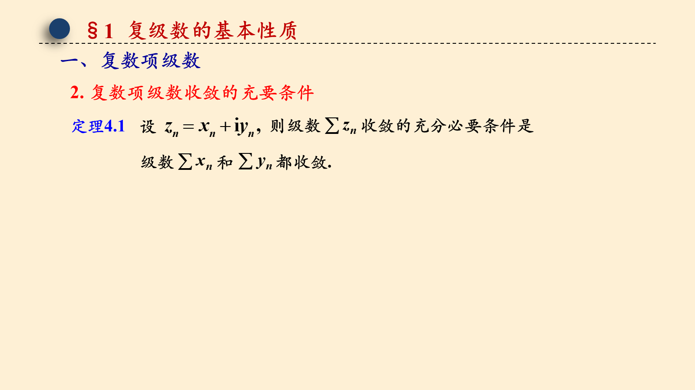
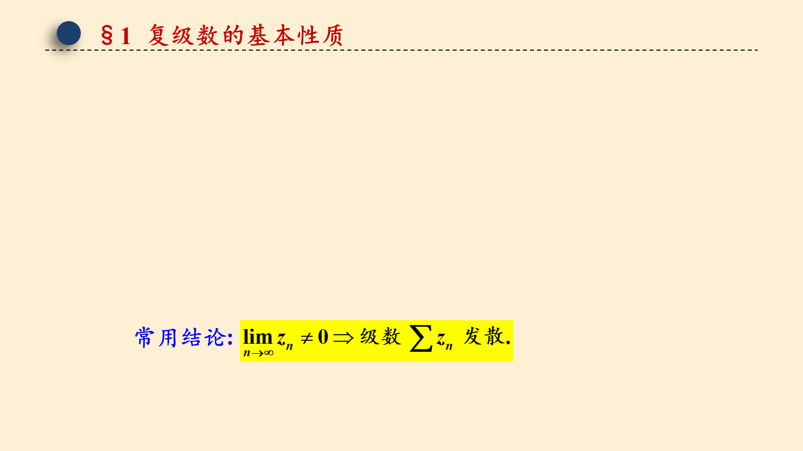
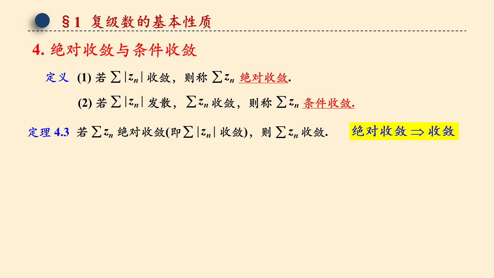
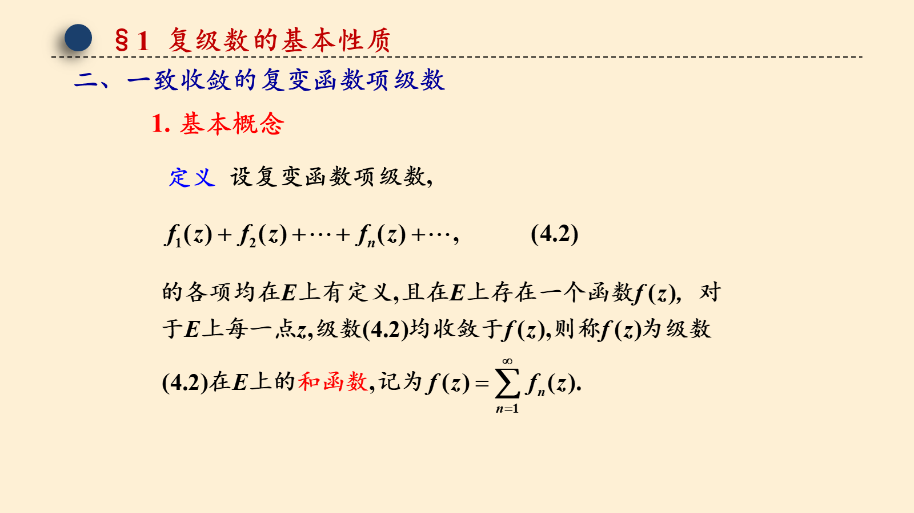
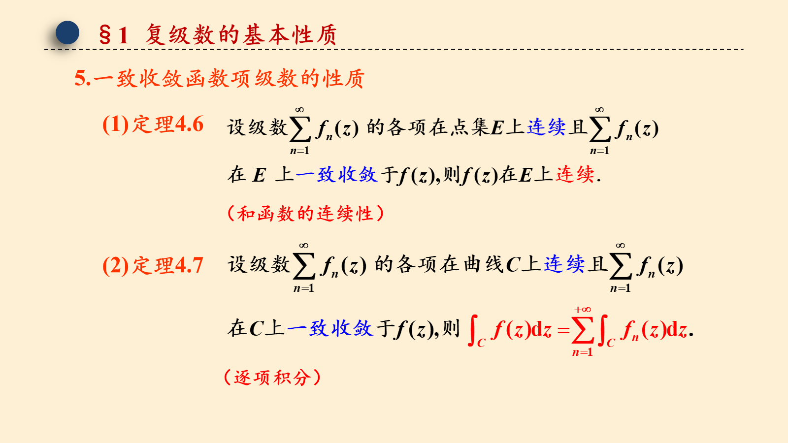
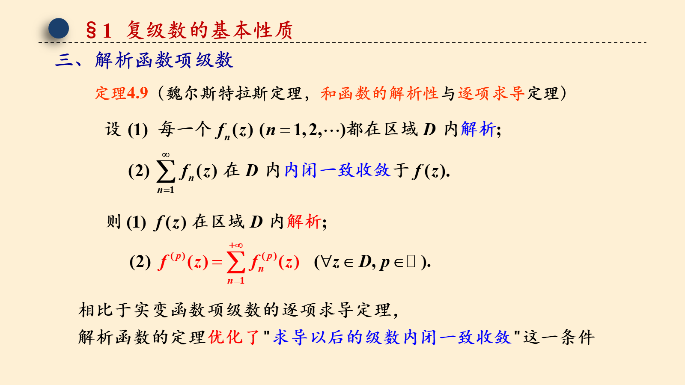

# 4.1 复级数的基本性质

> 来源：4.1 复级数的基本性质.pptx，共 11 页。
> 公式与图形较多，含图页保留整页图像以保证版式；纯文字页转为正文。

## 第 1 页

第四章 解析函数的幂级数表示法

4.1 复级数的基本性质

梅杰

## 第 2 页

§1 复级数的基本性质
一、复数项级数
1. 基本概念
（4.1）
则称级数收敛，
并且极限值 s 称为级数的和；

## 第 3 页

§1 复级数的基本性质

## 第 4 页

§1 复级数的基本性质
一、复数项级数
2. 复数项级数收敛的充要条件

## 第 5 页

§1 复级数的基本性质
常用结论:

## 第 6 页

§1 复级数的基本性质
4. 绝对收敛与条件收敛

## 第 7 页

§1 复级数的基本性质
二、一致收敛的复变函数项级数
1. 基本概念
设复变函数项级数,
定义

## 第 8 页

§1 复级数的基本性质
二、一致收敛的复变函数项级数
2. 一致收敛的定义

## 第 9 页

§1 复级数的基本性质
5.一致收敛函数项级数的性质
(1)定理4.6
（和函数的连续性）
(2)定理4.7
（逐项积分）

## 第 10 页

§1 复级数的基本性质
6.内闭一致收敛
(1)定义4.5

## 第 11 页

§1 复级数的基本性质
三、解析函数项级数
定理4.9（魏尔斯特拉斯定理，和函数的解析性与逐项求导定理）

