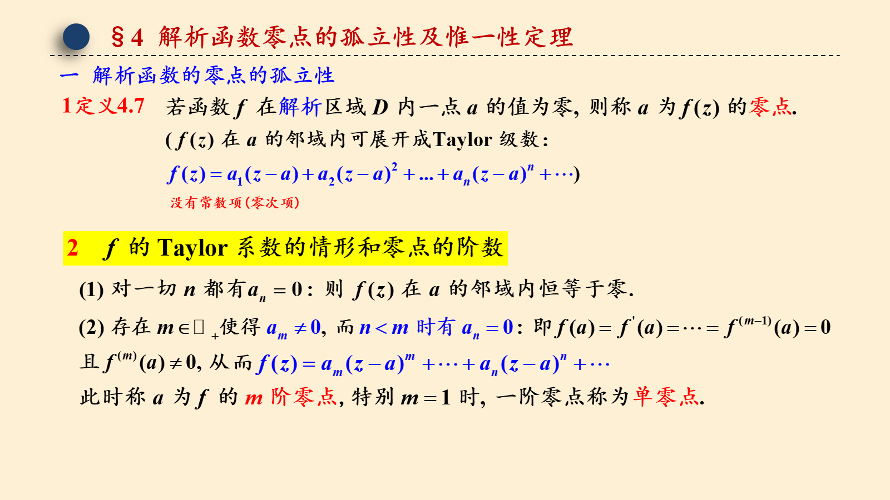
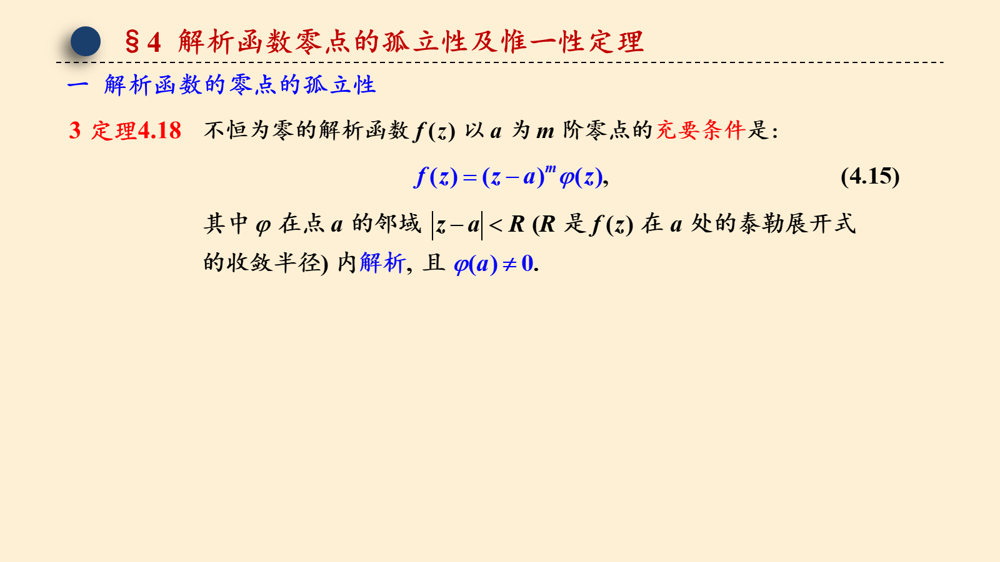
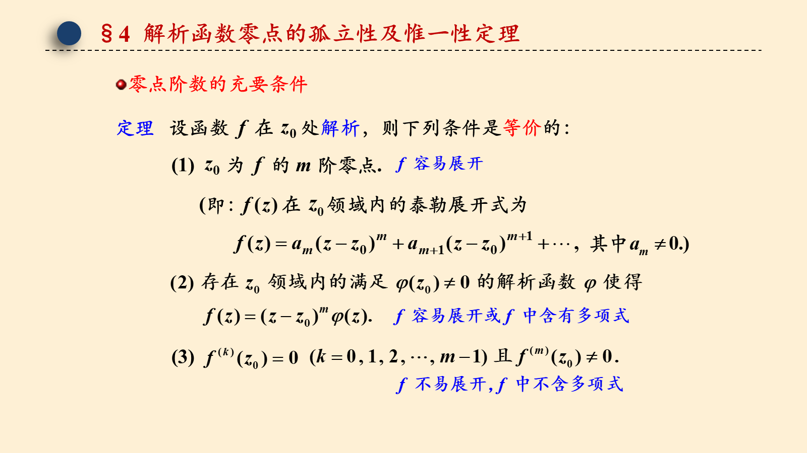
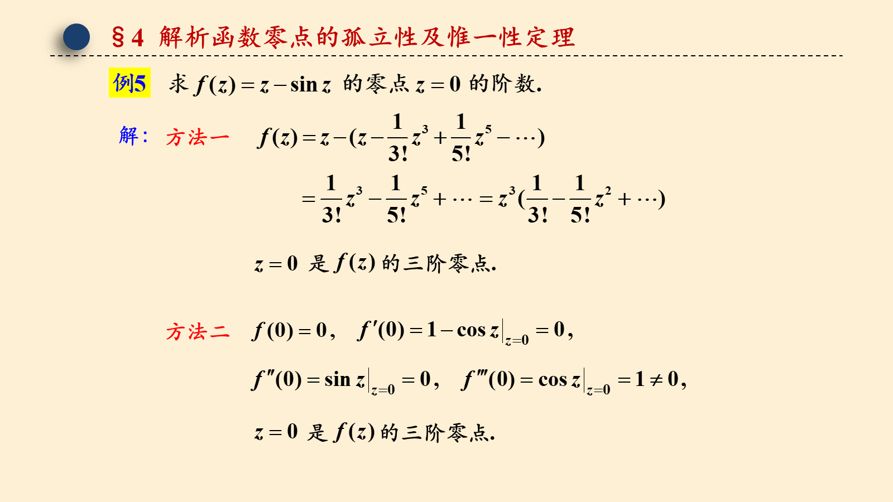
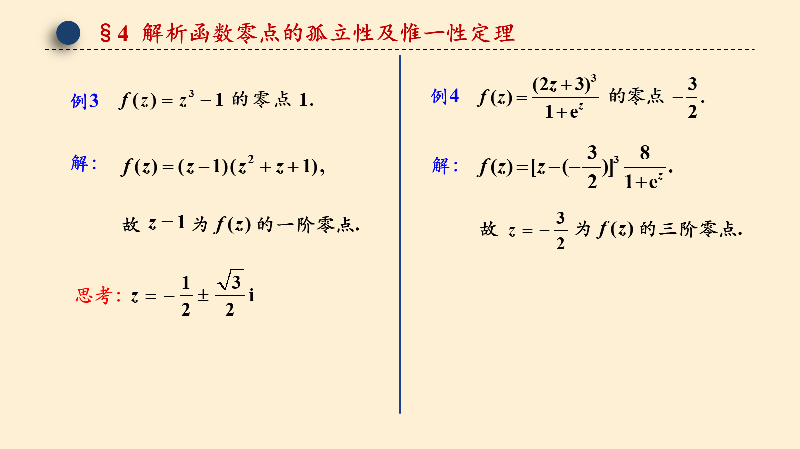
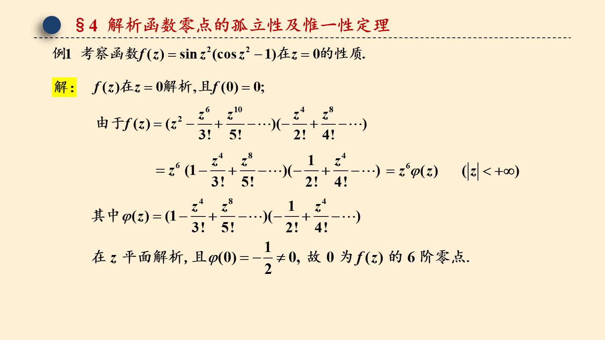
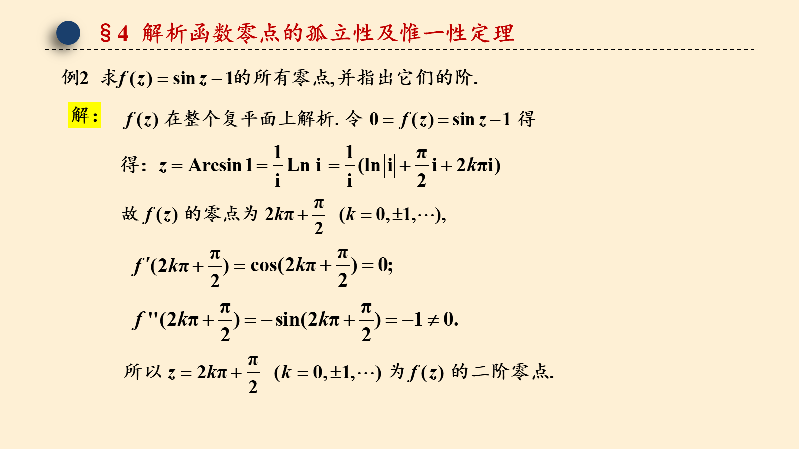
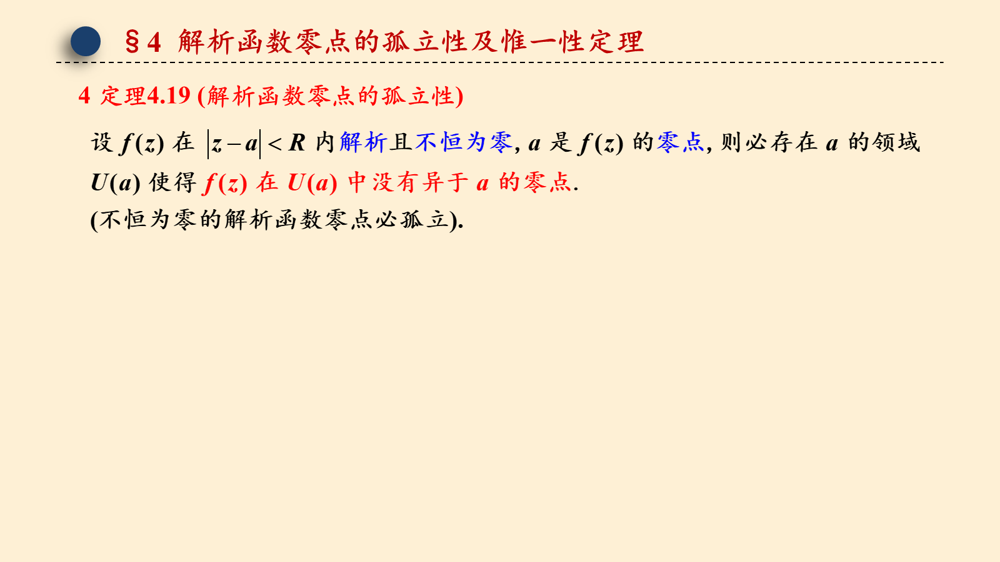
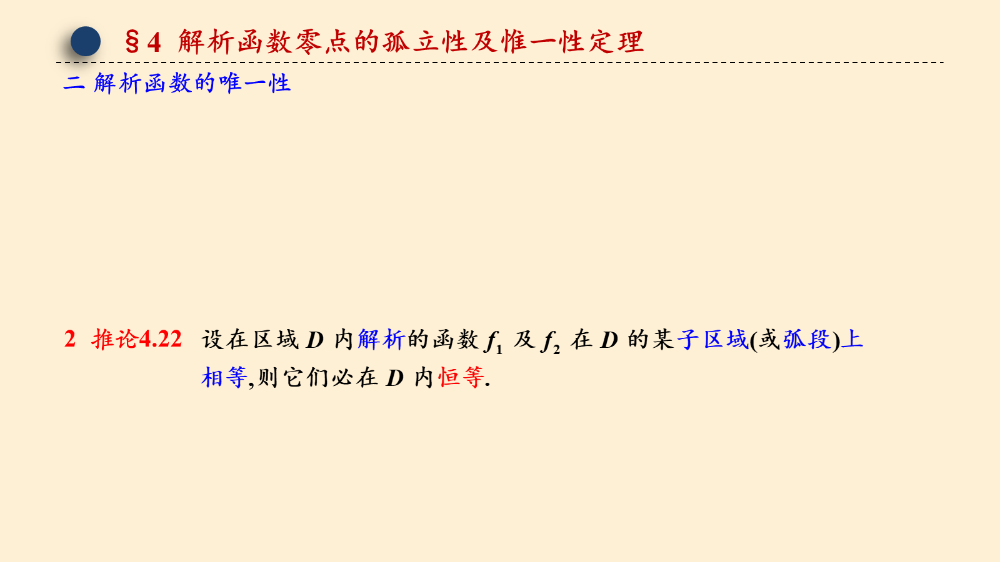
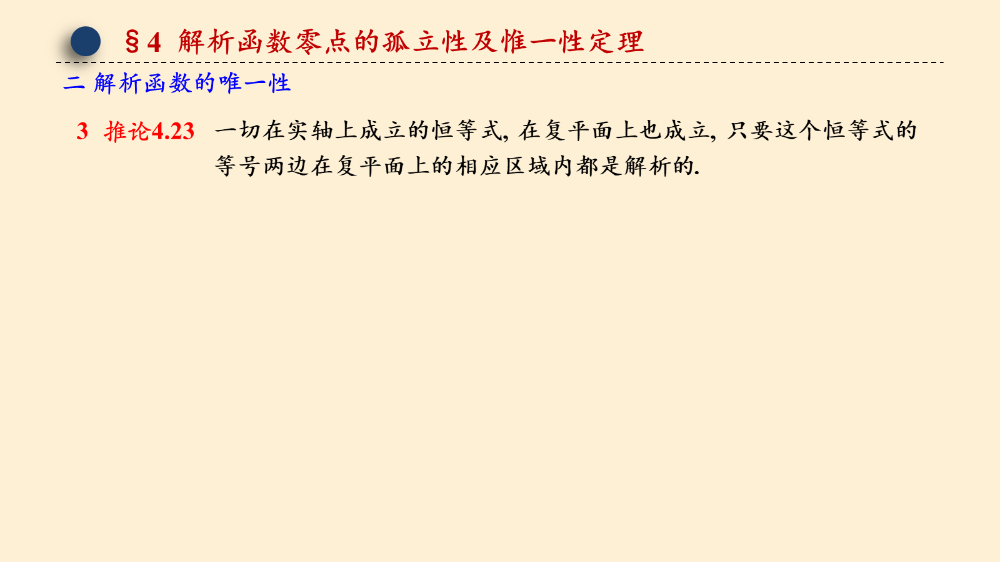

# 4.4 解析函数零点的孤立性和解析函数的唯一性

> 来源：4.4 解析函数零点的孤立性和解析函数的唯一性.pptx，共 12 页。
> 公式与图形较多，含图页保留整页图像以保证版式；纯文字页转为正文。

## 第 1 页

第四章 解析函数的幂级数表示法

4.4 解析函数零点的孤立性和唯一性定理

梅杰

## 第 2 页

§4 解析函数零点的孤立性及惟一性定理
一  解析函数的零点的孤立性
1定义4.7

## 第 3 页

§4 解析函数零点的孤立性及惟一性定理
一  解析函数的零点的孤立性
3 定理4.18

## 第 4 页

§4 解析函数零点的孤立性及惟一性定理
零点阶数的充要条件

## 第 5 页

§4 解析函数零点的孤立性及惟一性定理
解：

## 第 6 页

§4 解析函数零点的孤立性及惟一性定理
解：
解：

## 第 7 页

§4 解析函数零点的孤立性及惟一性定理

## 第 8 页

§4 解析函数零点的孤立性及惟一性定理

## 第 9 页

§4 解析函数零点的孤立性及惟一性定理

## 第 10 页

§4 解析函数零点的孤立性及惟一性定理
4 定理4.19 (解析函数零点的孤立性)

## 第 11 页

§4 解析函数零点的孤立性及惟一性定理
二 解析函数的唯一性
2  推论4.22

## 第 12 页

§4 解析函数零点的孤立性及惟一性定理
二 解析函数的唯一性
3  推论4.23

