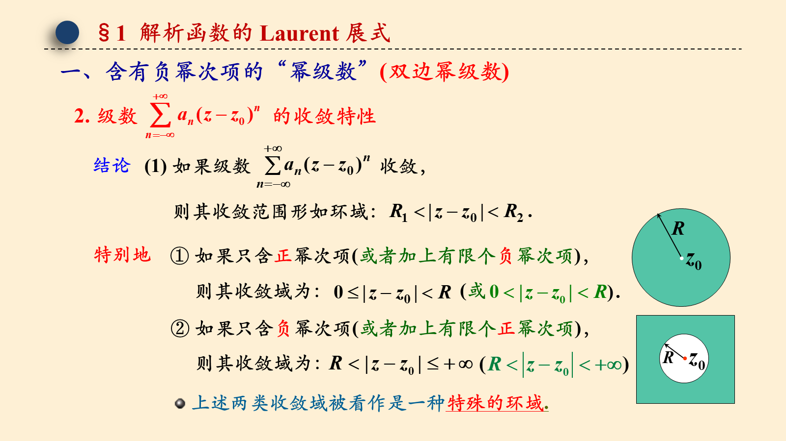
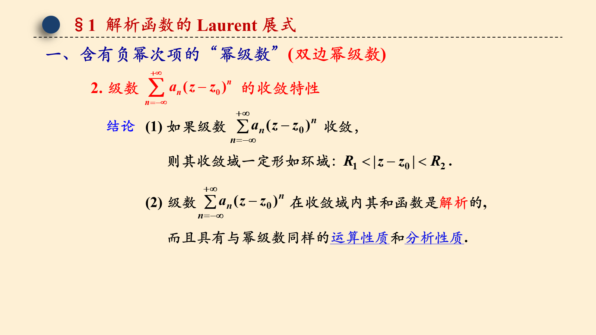
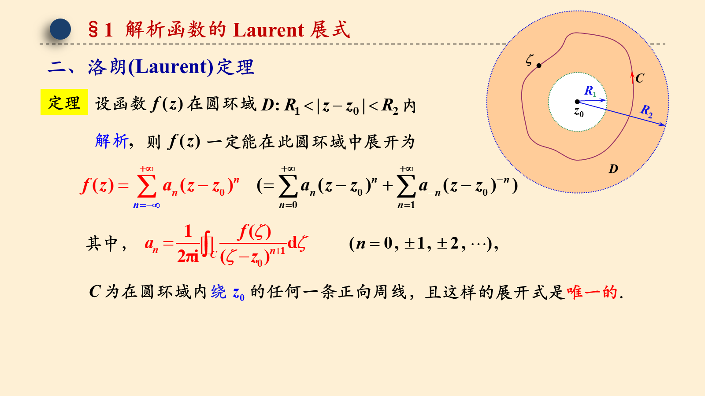
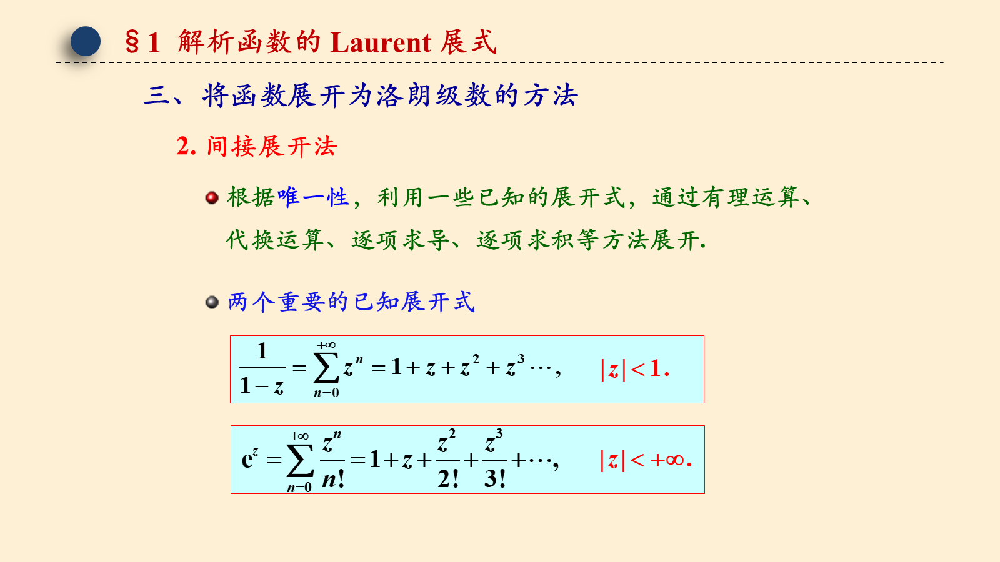
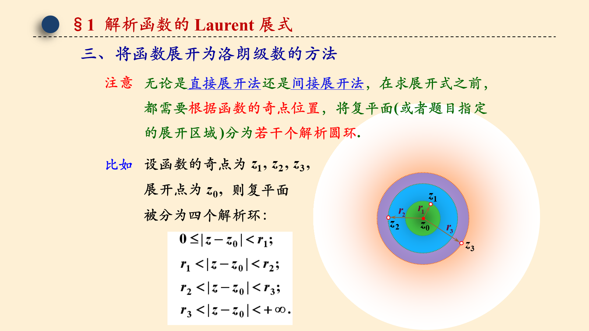
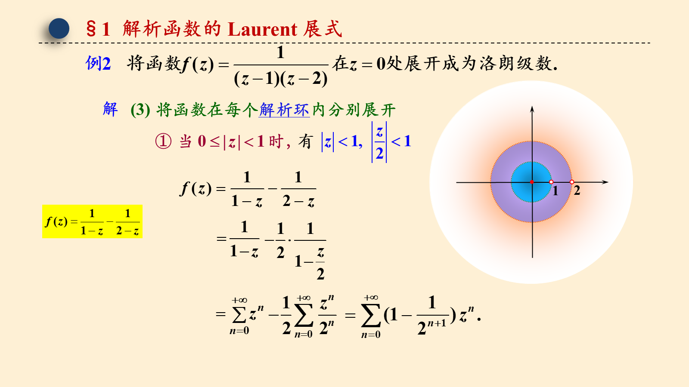
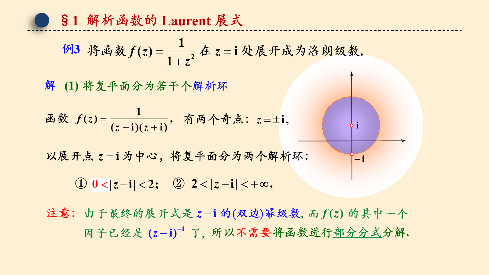
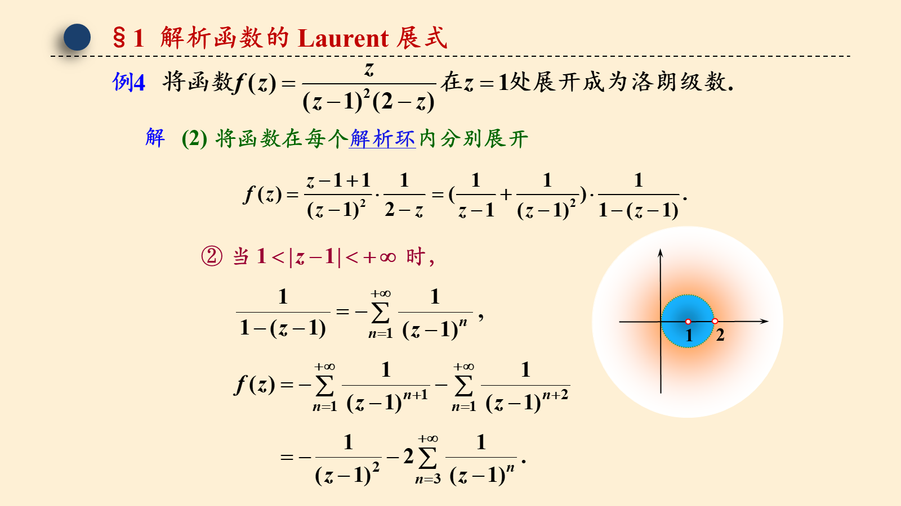

# 5.1 解析函数的 Laurent 展开式

> 来源：5.1 解析函数的 Laurent 展开式.pptx，共 21 页。
> 公式与图形较多，含图页保留整页图像以保证版式；纯文字页转为正文。

## 第 1 页

第五章 解析函数的 Laurent 展式与孤立奇点

5.1 解析函数的 Laurent 展式

梅杰

## 第 2 页

§1  解析函数的 Laurent 展式
一、含有负幂次项的“幂级数”(双边幂级数)
结论
特别地
① 如果只含正幂次项(或者加上有限个负幂次项)，
② 如果只含负幂次项(或者加上有限个正幂次项)，
上述两类收敛域被看作是一种特殊的环域.

## 第 3 页

§1  解析函数的 Laurent 展式
一、含有负幂次项的“幂级数”(双边幂级数)
结论
而且具有与幂级数同样的运算性质和分析性质.

## 第 4 页

§1  解析函数的 Laurent 展式
二、洛朗(Laurent)定理
解析,
且这样的展开式是唯一的.

## 第 5 页

§1  解析函数的 Laurent 展式
二、洛朗(Laurent)定理
(2) 洛朗级数                                        的展开中心     就是
的解析圆环                             的中心     .
注
(3) 一个在某圆环域内解析的函数展开为含有正负幂次项
的级数是唯一的.
在此圆环内的洛朗展开式就是泰勒展开式.

## 第 6 页

§1  解析函数的 Laurent 展式
三、将函数展开为洛朗级数的方法
2. 间接展开法
根据唯一性，利用一些已知的展开式，通过有理运算、
代换运算、逐项求导、逐项求积等方法展开.
两个重要的已知展开式

## 第 7 页

§1  解析函数的 Laurent 展式
三、将函数展开为洛朗级数的方法
都需要根据函数的奇点位置，将复平面(或者题目指定
的展开区域 )分为若干个解析圆环.
则复平面
被分为四个解析环：

## 第 8 页

§1  解析函数的 Laurent 展式
将复平面分为三个解析环：
(2) 将函数进行部分分式分解

## 第 9 页

§1  解析函数的 Laurent 展式
解
(3) 将函数在每个解析环内分别展开

## 第 10 页

§1  解析函数的 Laurent 展式
解
(3) 将函数在每个解析环内分别展开

## 第 11 页

§1  解析函数的 Laurent 展式
解
(3) 将函数在每个解析环内分别展开

## 第 12 页

§1  解析函数的 Laurent 展式
解

## 第 13 页

§1  解析函数的 Laurent 展式
将复平面分为两个解析环：
注意：
所以不需要将函数进行部分分式分解.

## 第 14 页

§1  解析函数的 Laurent 展式
解
(2) 将函数在每个解析环内分别展开

## 第 15 页

§1  解析函数的 Laurent 展式
解
(2) 将函数在每个解析环内分别展开

## 第 16 页

§1  解析函数的 Laurent 展式
解

## 第 17 页

§1  解析函数的 Laurent 展式
将复平面分为两个解析环：
注意：不需要将函数进行部分分式分解.

## 第 18 页

§1  解析函数的 Laurent 展式
解
(2) 将函数在每个解析环内分别展开

## 第 19 页

§1  解析函数的 Laurent 展式
解
(2) 将函数在每个解析环内分别展开

## 第 20 页

§1  解析函数的 Laurent 展式

## 第 21 页

§1  解析函数的 Laurent 展式

