# 6.1 留数

> 来源：6.1 留数.pptx，共 30 页。
> 公式与图形较多，含图页保留整页图像以保证版式；纯文字页转为正文。

## 第 1 页

第六章 留数理论及其应用

6.1 留数

梅杰

## 第 2 页

§1 留数
一、留数的概念
记作

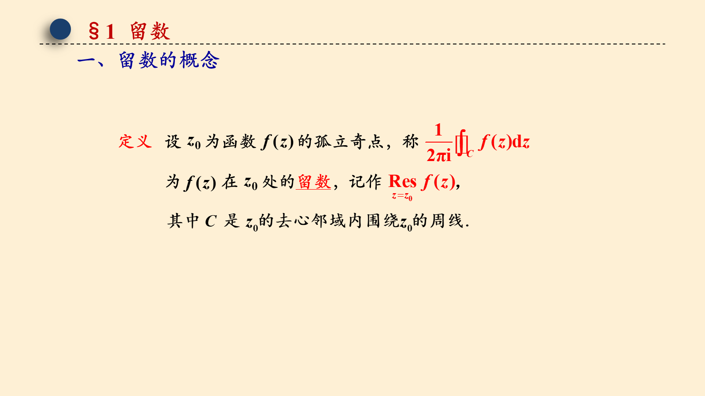

## 第 3 页

§1 留数
Cauchy 留数定理

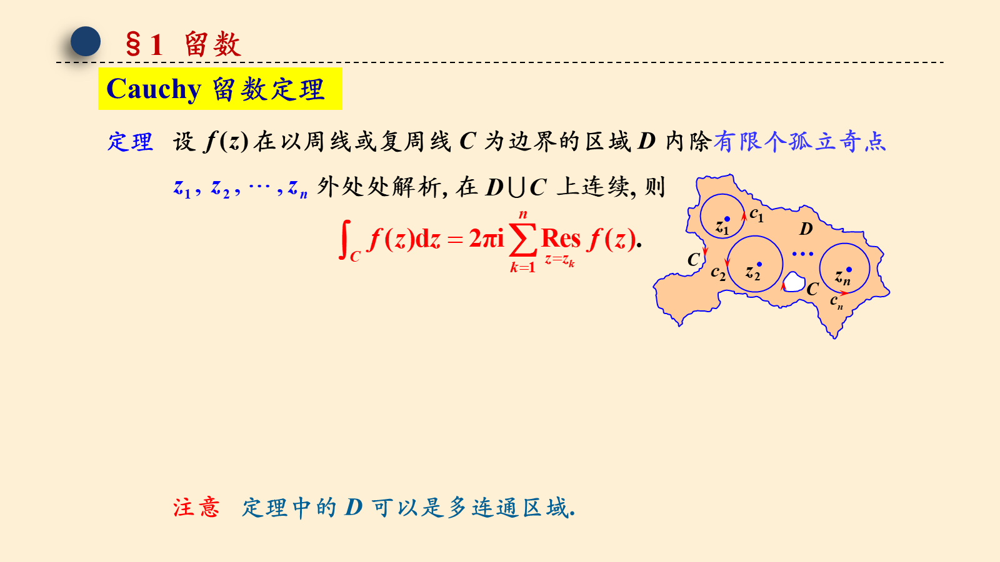

## 第 4 页

§1 留数
一、留数的概念
记作
等价定义
内展开成洛朗级数：
(两边积分)

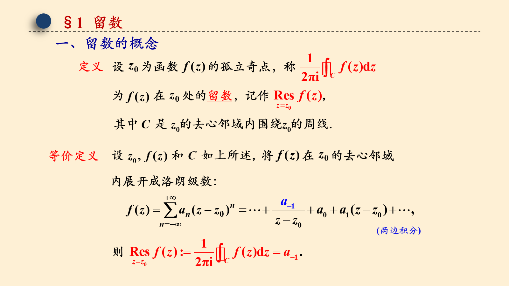

## 第 5 页

§1 留数
二、留数的求法
1. 可去奇点
2. 本性奇点
邻域内展开成洛朗级数并求       .
(2) 对于不是本性奇点的情况，该方法有时也是很有效的，
而且在使用该方法时，并不需要知道奇点的类型.

## 第 6 页

§1 留数
3. 极点

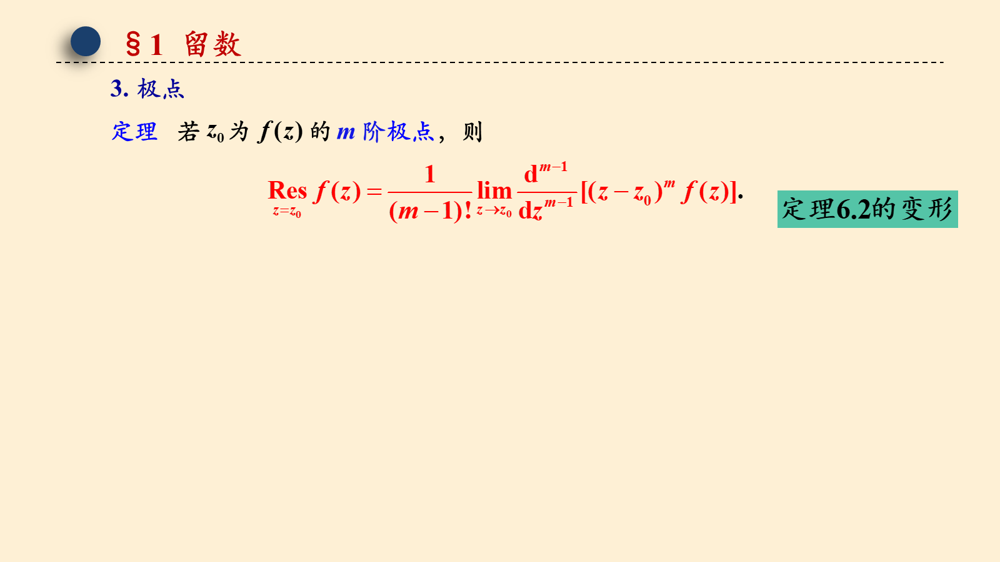

## 第 7 页

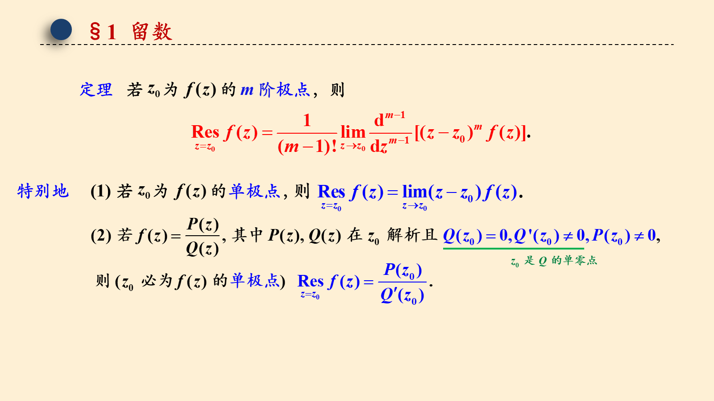

## 第 8 页

§1 留数
解:

## 第 9 页

§1 留数
解:

## 第 10 页

§1 留数
解:

## 第 11 页

§1 留数
解:

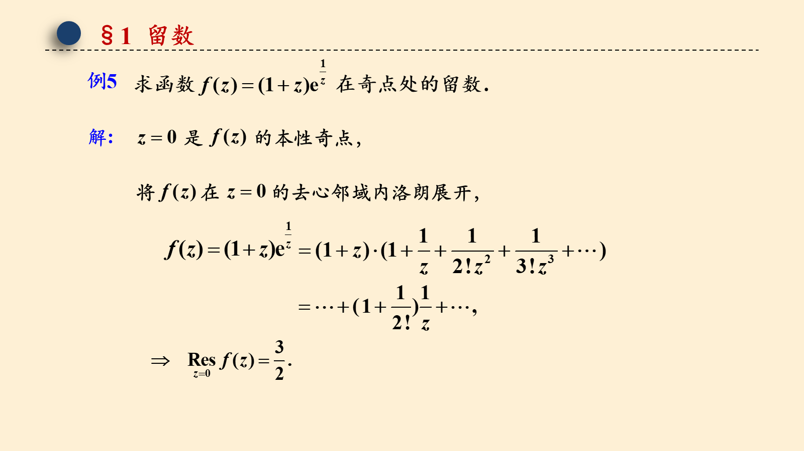

## 第 12 页

§1 留数
解:

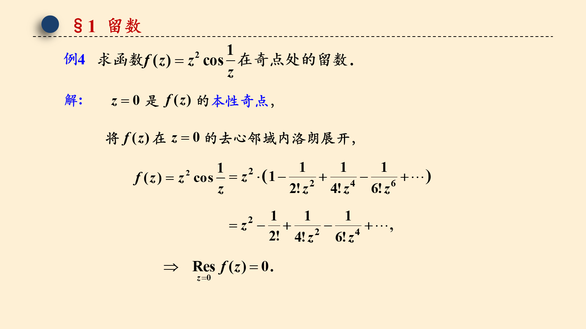

## 第 13 页

§1 留数
解:
方法一   利用洛朗展式求留数

## 第 14 页

§1 留数
解:
方法二   利用极点的留数计算公式求解
因此有
(洛必达法则)
(好麻烦!)

## 第 15 页

§1 留数
解:
方法二   利用极点的留数计算法则求解
巧合?

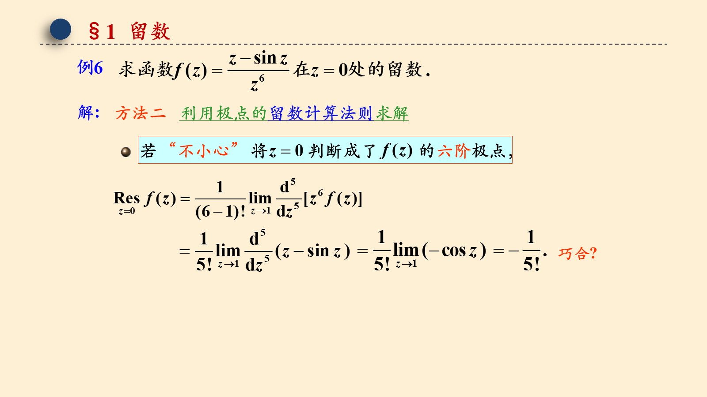

## 第 16 页

§1 留数
附：关于极点的留数计算法则的说明

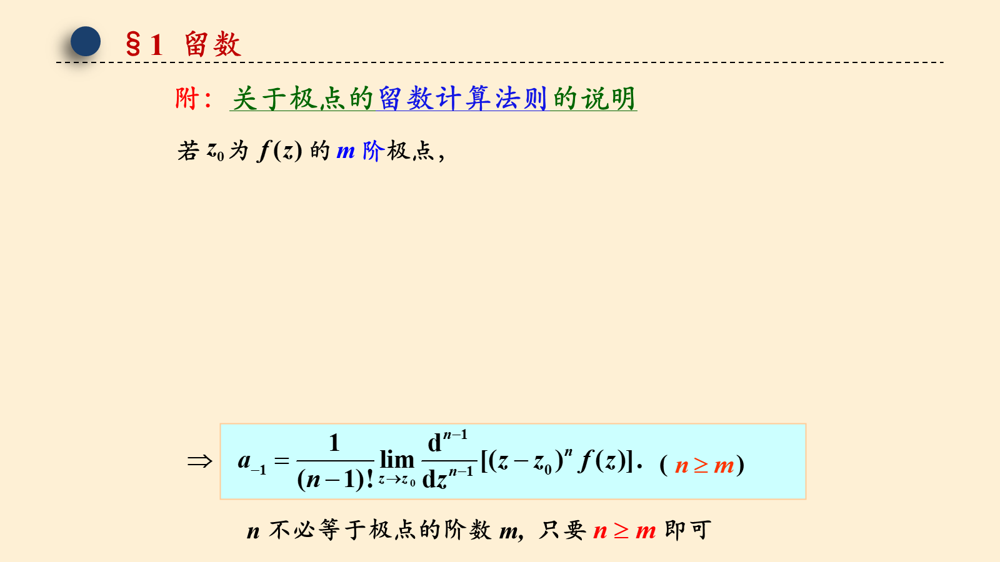

## 第 17 页

§1 留数
Cauchy 留数定理
注：解题时要充分观察被积函数 f (z) 在 C 内的解析情况和奇点分布，只有在 Cauchy 积分定理、Cauchy 积分公式、高阶导数公式甚至直接计算等难以应用的时候才需要用留数来计算积分.

## 第 18 页

§1 留数
解:

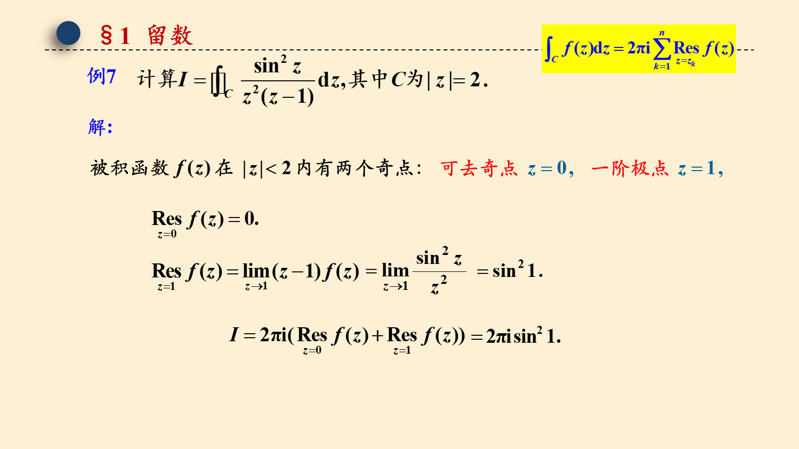

## 第 19 页

§1 留数
解:

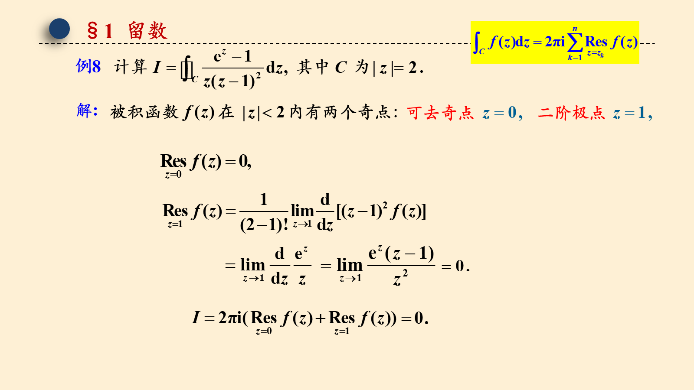

## 第 20 页

§1 留数
解:

## 第 21 页

§1 留数
解:

## 第 22 页

§1 留数
解:
方法一   利用极点的留数计算公式求解
利用高阶导数公式求解
方法二

## 第 23 页

§1 留数
解:
方法三   利用洛朗展式求留数再求解

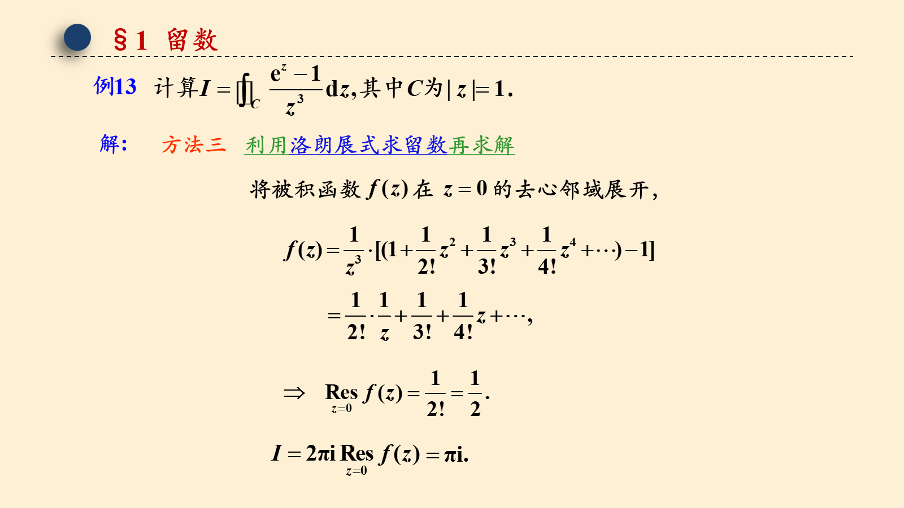

## 第 24 页

§1 留数
解:

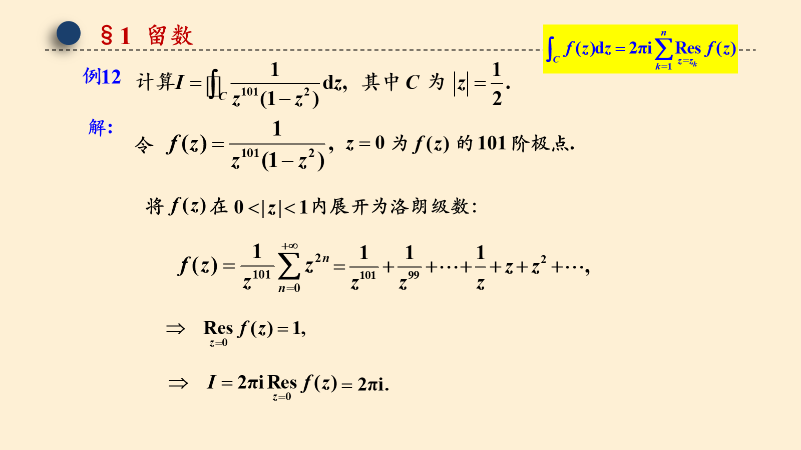

## 第 25 页

§1 留数
三、函数在无穷远点的留数
2. 函数在无穷远点的留数

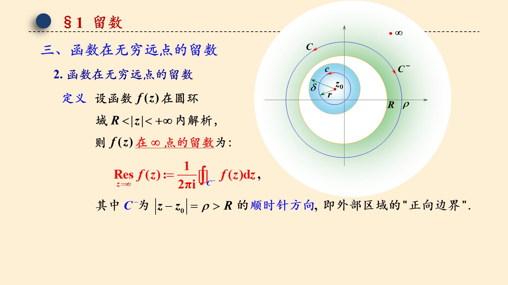

## 第 26 页

§1 留数
三、函数在无穷远点的留数
如何计算在无穷远点的留数？

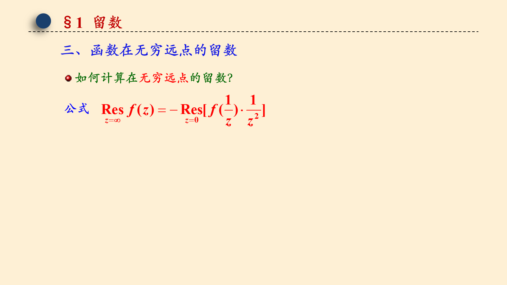

## 第 27 页

§1 留数
三、函数在无穷远点的留数
2. 函数在无穷远点的留数
在无穷远点的留数怎么用？
则
外处处解析，

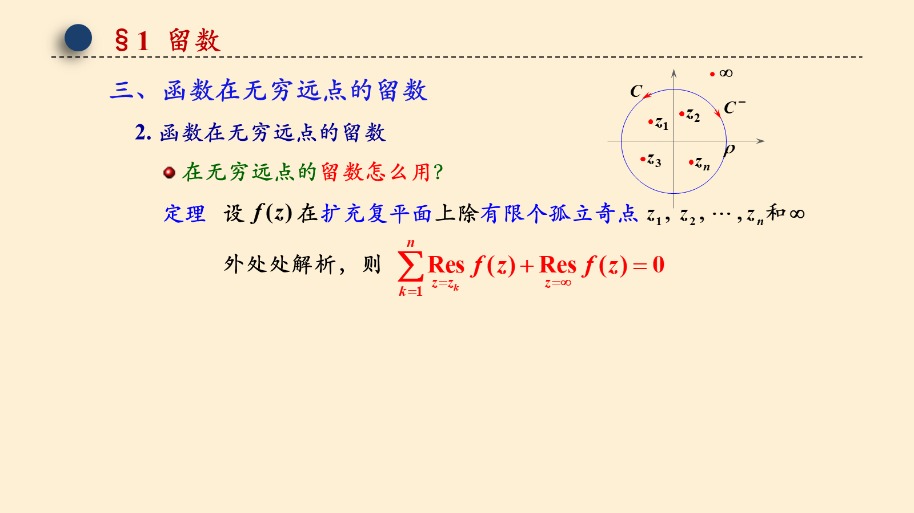

## 第 28 页

§1 留数
解:
由留数定理有

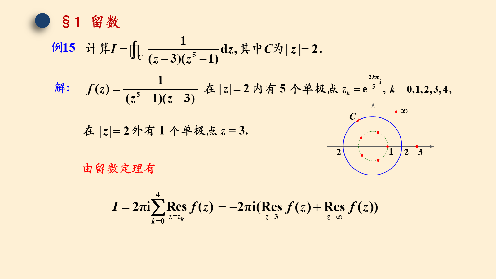

## 第 29 页

§1 留数
解

## 第 30 页

§1 留数
解:
由留数定理有

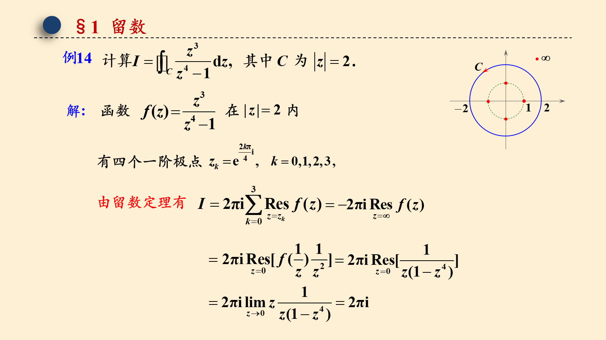

