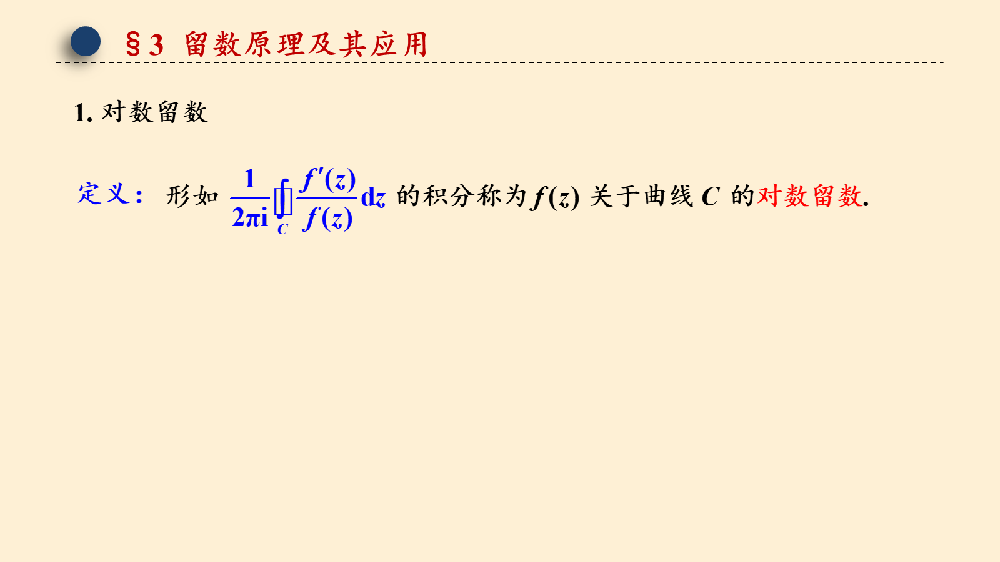
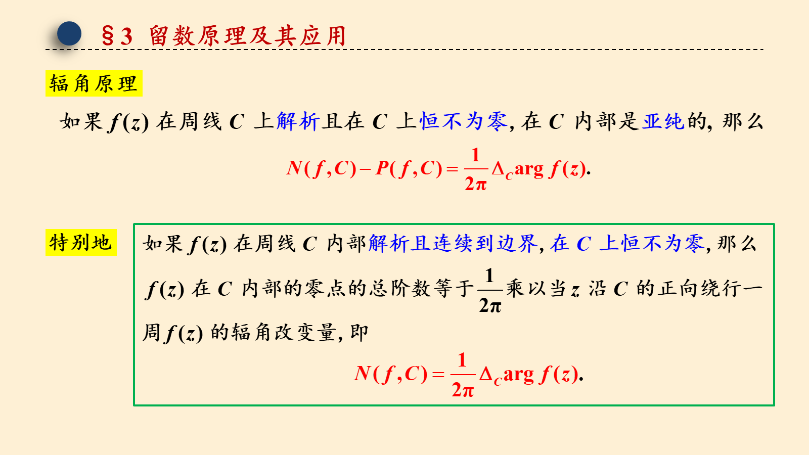
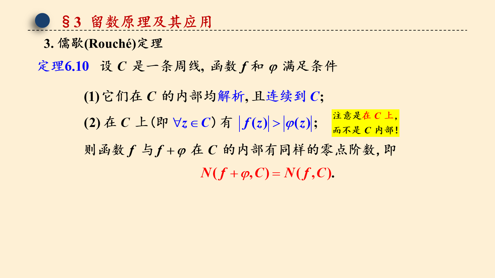

# 6.3 辐角原理及其应用

> 来源：6.3 辐角原理及其应用.pptx，共 4 页。
> 公式与图形较多，含图页保留整页图像以保证版式；纯文字页转为正文。

## 第 1 页

第六章 留数理论及其应用

6.3 辐角原理及其应用

梅杰

## 第 2 页

§3 留数原理及其应用

## 第 3 页

§3 留数原理及其应用

## 第 4 页

§3 留数原理及其应用
3. 儒歇(Rouché)定理

