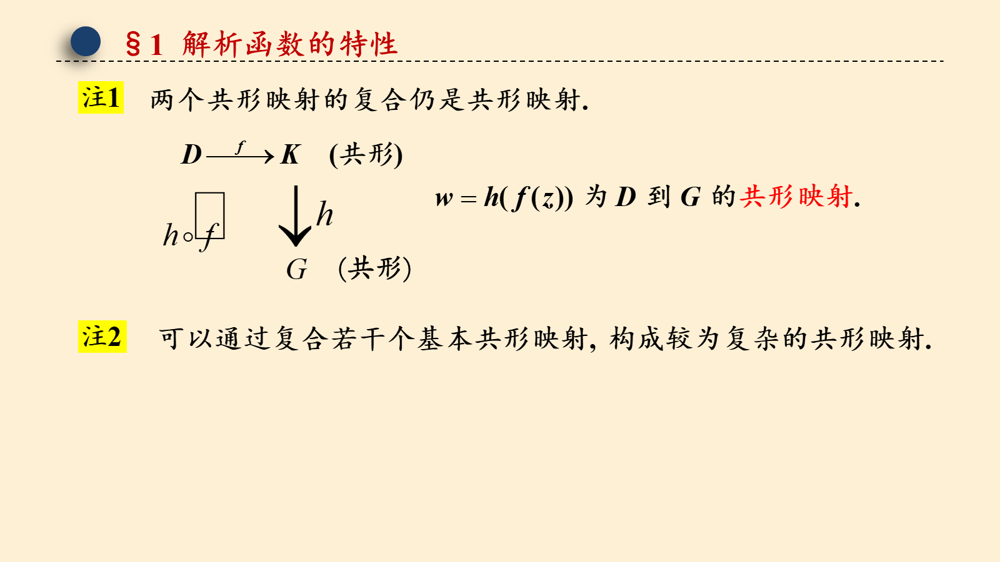

# 7.1 解析变换的特性

> 来源：7.1 解析变换的特性.pptx，共 8 页。
> 公式与图形较多，含图页保留整页图像以保证版式；纯文字页转为正文。

## 第 1 页

第七章 共形映射

7.1 解析变换的特性

梅杰

## 第 2 页

§1 解析函数的特性
二、解析函数的保角性
切线
分析
切线
1. 导数的几何意义

## 第 3 页

§1 解析函数的特性
切线
2. 伸缩率不变性
切线
3. 旋转角不变性
即

## 第 4 页

§1 解析函数的特性
切线
4. 保角性
切线

## 第 5 页

§1 解析函数的特性
三、单叶解析变换的共形性
1. 保角变换（映射）
区域 D 内是保角的。

## 第 6 页

§1 解析函数的特性
三、单叶解析变换的共形性
3. 共形映射
的共形映射。

## 第 7 页

§1 解析函数的特性
三、单叶解析变换的共形性

## 第 8 页

§1 解析函数的特性

