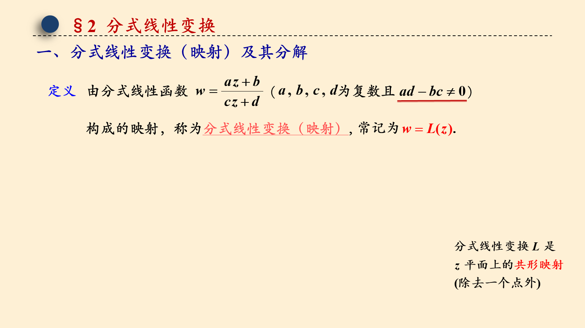
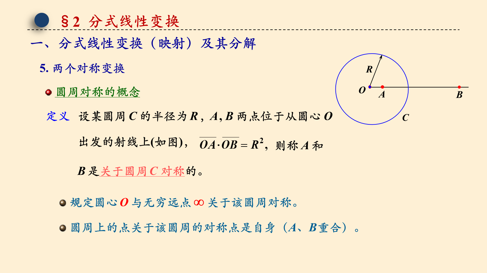
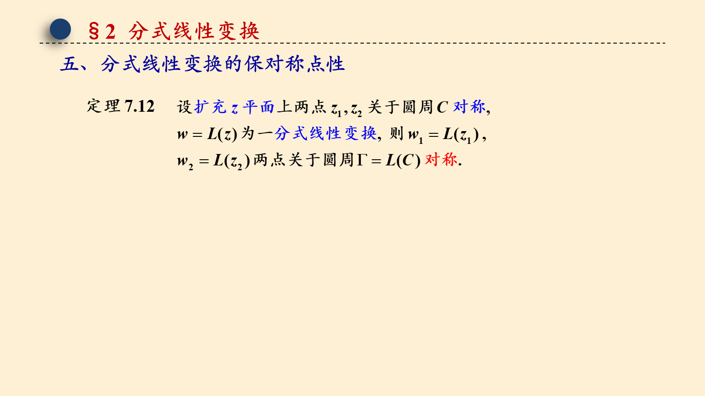
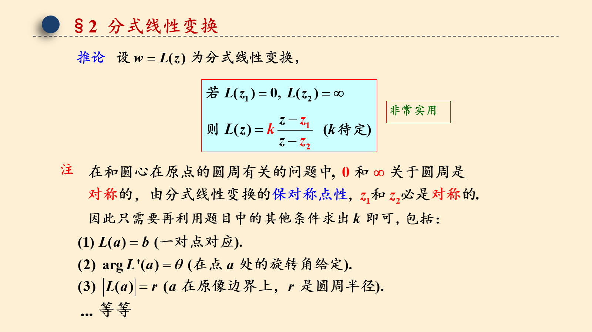
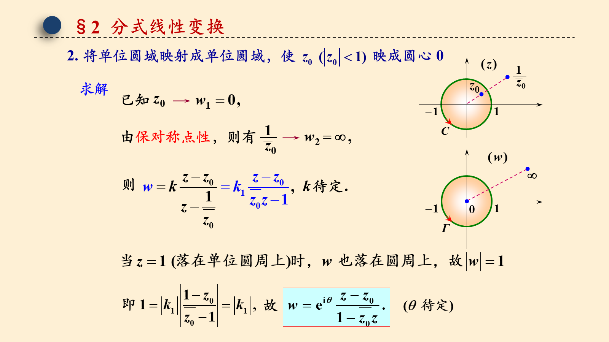

# 7.2 分式线性变换（两次课的内容）

> 来源：7.2 分式线性变换（两次课的内容）.pptx，共 15 页。
> 公式与图形较多，含图页保留整页图像以保证版式；纯文字页转为正文。

## 第 1 页

第七章 共形映射

7.2 分式线性变换

梅杰

## 第 2 页

§2 分式线性变换
一、分式线性变换（映射）及其分解
定义

## 第 3 页

§2 分式线性变换
一、分式线性变换（映射）及其分解
5. 两个对称变换
R
O
圆周对称的概念
A
B
A , B 两点位于从圆心 O
C
出发的射线上(如图)，
则称 A 和
B 是关于圆周 C 对称的。
圆周上的点关于该圆周的对称点是自身（A、B重合）。

## 第 4 页

§2 分式线性变换
二、分式线性变换的共形性

## 第 5 页

§2 分式线性变换

三、分式线性变换的保交比性

在扩充复平面上，3 组对应点唯一确定一个分式线性变换！

## 第 6 页

§2 分式线性变换

四、分式线性变换的保圆周(圆)性

## 第 7 页

§2 分式线性变换

四、分式线性变换的保圆周(圆)性

则它就映射成半径有限的圆；

(2) 如果给定的圆(或直线)上有一点映射成无穷远点，

## 第 8 页

§2 分式线性变换
五、分式线性变换的保对称点性

## 第 9 页

§2 分式线性变换

六、分式线性变换的应用

上半平面和单位圆是两个非常典型的区域，利用分式线性变换，可实现这两个区域自身及区域之间的转换，而一般区域间的共形映射往往会归结为这两个区域间的转换。因此，这两个区域自身及区域之间的转换显得非常重要。下面通过例题来加以说明，这也可看作是分式线性变换的实际应用。

## 第 10 页

§2 分式线性变换
注

## 第 11 页

§2 分式线性变换
1. 将上半平面映射成单位圆，使                       映为圆心
特点
这两个区域的边界都是圆。
求解
即                                             ，
则
又

## 第 12 页

§2 分式线性变换
例 1
解：

## 第 13 页

§2 分式线性变换
2. 将单位圆域映射成单位圆域，使                    映成圆心 0
求解
则
故

## 第 14 页

§2 分式线性变换
例 2
解：

## 第 15 页

§2 分式线性变换

