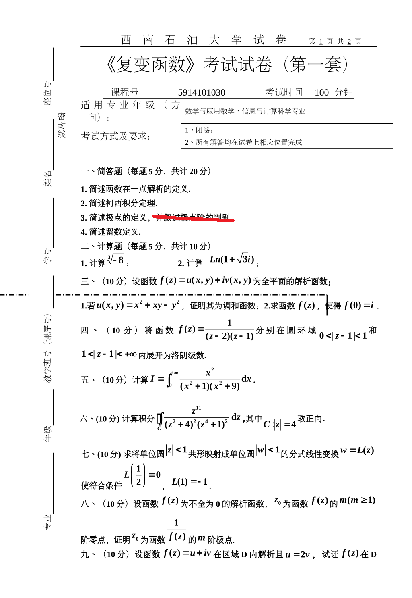
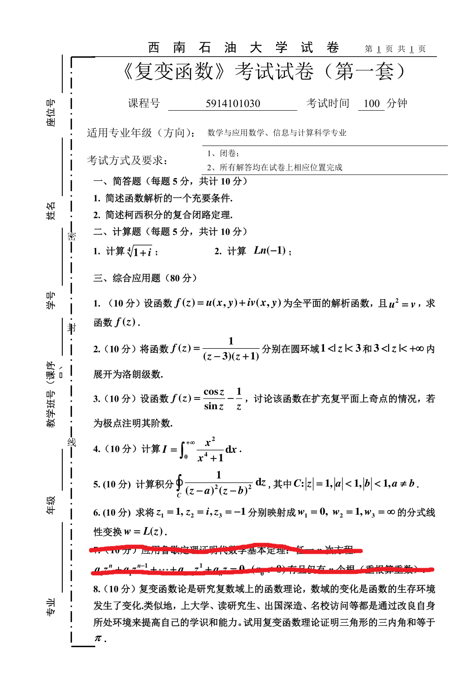
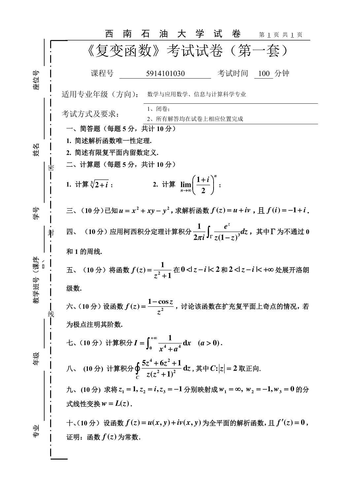
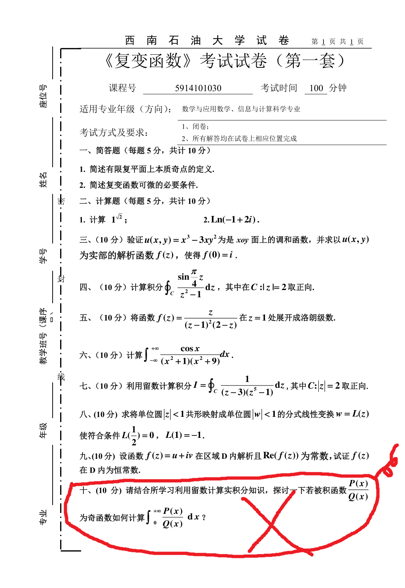

# 复变函数 模拟题（4 张）

> 来源：老师发的 `考试范围版 PPT + 模拟题.7z`，其中 4 张试卷图片。
> 下面是原图与自动转写。**转写是 OCR 结果，题号与公式请以原图为准**；页眉的「第几套」在四张图上都识别成「第一套」，明显不可靠，故本文件按文件名编号，不标套号。

---

## 模拟 1

西南石油大学试卷　第 1 页 共 2 页　《复变函数》考试试卷
课程号 5914101030　考试时间 100 分钟　适用：数学与应用数学、信息与计算科学

**一、简答题（每题 5 分，共 20 分）**

1. 简述函数在一点解析的定义。
2. 简述柯西积分定理。
3. 简述极点的定义，并叙述极点阶的判别。
4. 简述留数定义。

**二、计算题（每题 5 分，共 10 分）**

1. 计算 $\sqrt[3]{-8}$。
2. 计算 $\operatorname{Ln}(1+\sqrt{3}i)$。

**三、（10 分）** 设 $f(z)=u(x,y)+iv(x,y)$ 为全平面解析函数。

1. 若 $u(x,y)=x^2+xy-y^2$，证明其为调和函数；
2. 求 $f(z)$，使 $f(0)=i$。

**四、（10 分）** 将 $f(z)=\dfrac{1}{(z-2)(z-1)}$ 分别在 $0<|z-1|<1$ 与 $1<|z-1|<+\infty$ 内展开为洛朗级数。

**五、（10 分）** 计算 $I=\displaystyle\int_0^{+\infty}\frac{x^2}{(x^2+1)(x^2+9)}\,dx$。

**六、（10 分）** 计算 $\displaystyle\oint_C \frac{z^{11}}{(z^2+4)^2(z^4+1)^2}\,dz$，其中 $C:|z|=4$ 取正向。

**七、（10 分）** 求将单位圆 $|z|<1$ 共形映射成单位圆 $|w|<1$ 的分式线性变换 $w=L(z)$，使 $L\!\left(\frac12\right)=0$，$L(1)=-1$。

**八、（10 分）** 设 $f(z)$ 为不恒为零的解析函数，$z_0$ 是 $f$ 的 $m\ (m\ge1)$ 阶零点，证明 $z_0$ 是 $\dfrac{1}{f(z)}$ 的 $m$ 阶极点。

**九、（10 分）** 设 $f(z)=u+iv$ 在区域 $D$ 内解析且 $u=2v$，试证 $f(z)$ 在 $D$ 内……

> 原图在这里被截断（该页标「共 2 页」，第 2 页没给），第九题后半句与第十题缺失。

---

## 模拟 2

**一、简答题（每题 5 分，共 10 分）**

1. 简述函数解析的一个充要条件。
2. 简述柯西积分的复合闭路定理。

**二、计算题（每题 5 分，共 10 分）**

1. 计算 $\sqrt[3]{1+i}$。
2. 计算 $\operatorname{Ln}(-1)$。

**三、综合应用题（80 分）**

1. （10 分）设 $f(z)=u+iv$ 为全平面解析函数，且 $u^2=v$，求 $f(z)$。
2. （10 分）将 $f(z)=\dfrac{1}{(z-3)(z+1)}$ 分别在 $1<|z|<3$ 与 $3<|z|<+\infty$ 内展开为洛朗级数。
3. （10 分）设 $f(z)=\dfrac{\cos z}{\sin z}-\dfrac{1}{z}$，讨论其在扩充复平面上奇点的情况，若为极点注明阶数。
4. （10 分）计算 $I=\displaystyle\int_0^{+\infty}\frac{x^2}{x^4+1}\,dx$。
5. （10 分）计算 $\displaystyle\oint_C \frac{1}{(z-a)^2(z-b)^2}\,dz$，其中 $C:|z|=1$，$|a|<1$，$|b|<1$，$a\neq b$。
6. （10 分）求将 $z_1=1,\ z_2=i,\ z_3=-1$ 分别映射成 $w_1=0,\ w_2=1,\ w_3=\infty$ 的分式线性变换 $w=L(z)$。
7. （10 分）用鲁歇定理证明代数基本定理：任一 $n$ 次方程 $a_nz^n+\cdots+a_1z+a_0=0\ (a_n\neq0)$ 有且仅有 $n$ 个根（含重数）。
8. （10 分）用复变函数理论证明三角形的三内角和等于 $\pi$。

---

## 模拟 3

**一、简答题（每题 5 分，共 10 分）**

1. 简述解析函数唯一性定理。
2. 简述有限复平面内留数的定义。

**二、计算题（每题 5 分，共 10 分）**

1. 计算 $\sqrt[3]{2+i}$。
2. 计算 $\displaystyle\lim_{n\to\infty}\left(\frac{1+i}{2}\right)^n$。

**三、（10 分）** 已知 $u=x^2+xy-y^2$，求解析函数 $f(z)=u+iv$，且 $f(i)=-1+i$。

**四、（10 分）** 应用柯西积分定理计算 $\dfrac{1}{2\pi i}\displaystyle\int_\Gamma \frac{e^z}{z(1-z)^3}\,dz$，其中 $\Gamma$ 为不通过 $0$ 和 $1$ 的周线。

**五、（10 分）** 将 $f(z)=\dfrac{1}{z^2+1}$ 在 $0<|z-i|<2$ 与 $2<|z-i|<+\infty$ 内展开洛朗级数。

**六、（10 分）** 设 $f(z)=\dfrac{1-\cos z}{z^2}$，讨论其在扩充复平面上奇点的情况，若为极点注明阶数。

**七、（10 分）** 计算 $I=\displaystyle\int_0^{+\infty}\frac{1}{x^4+a^4}\,dx\ (a>0)$。

**八、（10 分）** 计算 $\displaystyle\oint_C \frac{5z^4+6z^2+1}{z(z^2+1)^2}\,dz$，其中 $C:|z|=2$ 取正向。

**九、（10 分）** 求将 $z_1=1,\ z_2=i,\ z_3=-1$ 分别映射成 $w_1=\infty,\ w_2=-1,\ w_3=0$ 的分式线性变换 $w=L(z)$。

**十、（10 分）** 设 $f(z)=u+iv$ 为全平面解析函数，且 $f'(z)=0$，证明 $f(z)$ 为常数。

---

## 模拟 4

**一、简答题（每题 5 分，共 10 分）**

1. 简述有限复平面上本质奇点的定义。
2. 简述复变函数可微的必要条件。

**二、计算题（每题 5 分，共 10 分）**

1. 计算 $1^{\sqrt{2}}$。
2. 计算 $\operatorname{Ln}(-1+2i)$。

**三、（10 分）** 验证 $u(x,y)=x^3-3xy^2$ 是 $xOy$ 面上的调和函数，并求以 $u$ 为实部的解析函数 $f(z)$，使 $f(0)=i$。

**四、（10 分）** 计算 $\displaystyle\oint_C \frac{\sin\frac{\pi}{4}z}{z^2-1}\,dz$，其中 $C:|z|=2$ 取正向。

**五、（10 分）** 将 $f(z)=\dfrac{z}{(z-1)^2(2-z)}$ 在 $z=1$ 处展开成洛朗级数。

**六、（10 分）** 计算 $\displaystyle\int_{-\infty}^{+\infty}\frac{\cos x}{(x^2+1)(x^2+9)}\,dx$。

**七、（10 分）** 利用留数计算 $I=\displaystyle\oint_C \frac{1}{(z-3)(z^5-1)}\,dz$，其中 $C:|z|=2$ 取正向。

**八、（10 分）** 求将单位圆 $|z|<1$ 共形映射成单位圆 $|w|<1$ 的分式线性变换 $w=L(z)$，使 $L\!\left(\frac12\right)=0$，$L(1)=-1$。

**九、（10 分）** 设 $f(z)=u+iv$ 在区域 $D$ 内解析且 $\operatorname{Re} f(z)$ 为常数，试证 $f(z)$ 在 $D$ 内为常数。

**十、（10 分）** 结合所学留数计算实积分的知识，探讨若被积函数 $\dfrac{P(x)}{Q(x)}$ 为奇函数，如何计算 $\displaystyle\int_0^{+\infty}\frac{P(x)}{Q(x)}\,dx$。

> 原图上第十题被红笔圈出并打叉。
